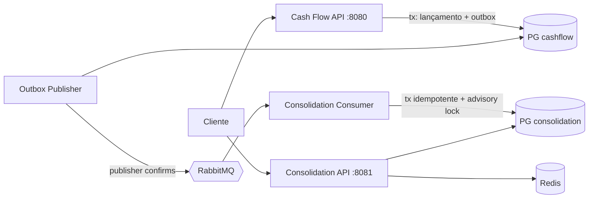

# Plataforma Multiempresa de Fluxo de Caixa

Plataforma em que comerciantes registram **créditos e débitos** e consultam o **saldo diário consolidado**. São dois microsserviços .NET 10 integrados por eventos via RabbitMQ.

## Arquitetura em 30 segundos



- **Cash Flow Service** é a fonte da verdade. Grava o lançamento e o evento (Outbox) na mesma transação e **continua funcionando se a consolidação ou o RabbitMQ caírem**.
- **Daily Consolidation Service** consome eventos de forma idempotente e mantém uma projeção de saldos diários. Toda resposta informa o **estado de consistência** (`CURRENT`, `PROCESSING`, `DELAYED` ou `UNKNOWN`).
- **Redis** é apenas cache, com fallback para PostgreSQL.
- **OpenTelemetry**: traces ponta a ponta (HTTP → Outbox → RabbitMQ → Consumer) no Jaeger, métricas no Prometheus/Grafana e logs JSON com `TraceId`.

📚 [Documentação](docs/README.md) · 🧭 [ADRs](docs/adr/README.md) · 📐 [SPEC](SPEC.md)

## Stack

.NET 10 · ASP.NET Core (Minimal APIs) · EF Core 10 + Npgsql · PostgreSQL 17 · RabbitMQ 4 · MassTransit 8.5 · Redis 8 · OpenTelemetry · Prometheus · Grafana · Jaeger · Docker Compose · xUnit · k6

## Pré-requisitos

| Para… | Precisa de |
|---|---|
| Rodar tudo (recomendado) | **Docker Desktop** (Windows/macOS) ou Docker Engine + Compose v2. O build .NET acontece dentro do container. |
| Compilar/testar fora do Docker | .NET SDK 10 |
| Teste de carga | k6 (ou a imagem `grafana/k6`) |

**Windows:** instale o Docker Desktop (`winget install Docker.DockerDesktop`), reinicie, abra o Docker Desktop uma vez e confirme com `docker version` e `docker compose version`. O Docker Desktop usa WSL 2 (`wsl --install` se pedido).

## Como rodar

```bash
cp .env.example .env              # opcional: o compose tem defaults de desenvolvimento
docker compose up --build -d      # 1ª vez: ~3-5 min (download de imagens + build .NET)
docker compose ps                 # migrators "Exited (0)", demais "healthy"/"running"
docker compose logs -f cashflow-api
docker compose down               # encerra
docker compose down -v            # encerra e APAGA os dados locais
```

Fora do Docker (somente build e testes): `dotnet restore && dotnet build && dotnet test`.

| Serviço | URL / porta | Credenciais (dev) |
|---|---|---|
| Cash Flow API (Swagger) | http://localhost:8080/swagger | token via `POST /dev/token` |
| Consolidation API (Swagger) | http://localhost:8081/swagger | mesmo token |
| RabbitMQ Management | http://localhost:15672 | `cashflow` / `cashflow_dev_pwd` (vhost `cashflow`) |
| Grafana | http://localhost:3000 | `admin` / `admin` (anônimo = leitura) |
| Jaeger | http://localhost:16686 | — |
| Prometheus | http://localhost:9090 | — |
| PostgreSQL cashflow / consolidation | `127.0.0.1:5432` / `127.0.0.1:5433` | ver `.env.example` |
| Redis | `127.0.0.1:6379` | — |

### Containers

| Container | Papel |
|---|---|
| `cashflow-migrator` / `consolidation-migrator` | Etapa controlada de migrations (`--migrate`); encerram com código 0 |
| `cashflow-api` | API REST de contas e lançamentos |
| `cashflow-outbox-publisher` | Lê a Outbox (`FOR UPDATE SKIP LOCKED`) e publica no RabbitMQ com confirms |
| `daily-consolidation-consumer` | Consome eventos, aplica a projeção de forma idempotente |
| `daily-consolidation-api` | API de consulta de saldos (cache-aside no Redis) |

Mesmo executável, papel definido por `Service__Role` — escala e falha independentes.

## Usando a API

### Autenticação de desenvolvimento

Em `Development` existe um emissor local de JWT (comerciantes demo **A** e **B**). Fora de `Development` a aplicação **recusa iniciar** se esse modo estiver ativo; em produção use `Authentication__Mode=Jwt` + `Authentication__Authority` (OIDC). O `MerchantId` vem **somente** da claim `merchant_id` do token.

No Swagger: execute `POST /dev/token` com `{"merchant":"A"}`, copie `access_token`, clique em **Authorize** e cole.

### Roteiro completo automatizado

```powershell
pwsh ./scripts/demo.ps1
```

Cria conta com saldo de abertura, crédito, débito, replay idempotente (200), conflito de chave (409), estorno e estorno duplicado (409), testes de isolamento entre comerciantes (404) e consulta o consolidado.

### Exemplo com curl

```bash
TOKEN=$(curl -s -X POST localhost:8080/dev/token -H 'Content-Type: application/json' -d '{"merchant":"A"}' | jq -r .access_token)

ACC=$(curl -s -X POST localhost:8080/api/v1/cash-accounts -H "Authorization: Bearer $TOKEN" -H 'Content-Type: application/json' \
  -d '{"name":"Caixa principal","currency":"BRL","timeZone":"America/Sao_Paulo","openingBalance":1000}' | jq -r .id)

curl -s -X POST localhost:8080/api/v1/transactions -H "Authorization: Bearer $TOKEN" -H 'Content-Type: application/json' \
  -H "Idempotency-Key: venda-001" \
  -d "{\"cashAccountId\":\"$ACC\",\"type\":\"CREDIT\",\"amount\":500.00,\"description\":\"Venda\",\"occurredAt\":\"$(date -u +%FT%TZ)\"}"

curl -s "localhost:8081/api/v1/daily-balances/$(date +%F)?cashAccountId=$ACC" -H "Authorization: Bearer $TOKEN"
```

### Contratos (resumo)

| Método | Rota | Observações |
|---|---|---|
| POST | `/api/v1/cash-accounts` | `openingBalance` opcional → lançamento `OPENING_BALANCE` auditável |
| GET | `/api/v1/cash-accounts[/{id}]` | |
| POST | `/api/v1/transactions` | `Idempotency-Key` obrigatório. Nova: **201**. Mesma chave+payload: **200** + `Idempotent-Replayed: true`. Payload diferente: **409** |
| GET | `/api/v1/transactions/{id}` | 404 se não existir **ou** for de outro comerciante |
| GET | `/api/v1/transactions?cashAccountId&from&to&page&pageSize` | `pageSize ≤ 100`, ordenação `occurredAt, id` |
| POST | `/api/v1/transactions/{id}/reversals` | Estorno integral compensatório; repetido → 409 |
| GET | `/api/v1/daily-balances?cashAccountId&from&to` | Todos os dias do período (≤ 366) |
| GET | `/api/v1/daily-balances/{yyyy-MM-dd}?cashAccountId` | |
| GET | `/api/v1/daily-balances/status?cashAccountId` | Estado da projeção (watermark por sequência) |
| GET | `/health/live`, `/health/ready`, `/metrics` | Anônimos |

Erros seguem **ProblemDetails** com `code` e `traceId`.

## Demonstração de resiliência

```bash
docker compose stop daily-consolidation-consumer   # consolidação fora
pwsh ./scripts/demo.ps1                            # lançamentos continuam 201; fila acumula (painel RabbitMQ)
                                                   # /status passa a UNKNOWN (sem heartbeat do consumidor)
docker compose start daily-consolidation-consumer  # backlog drenado, saldo correto, status CURRENT

docker compose stop rabbitmq                       # lançamentos continuam 201; Outbox acumula (métrica outbox_pending)
docker compose start rabbitmq                      # publisher drena a Outbox

docker compose stop redis                          # consultas continuam via PostgreSQL (/health/ready = Degraded)
docker compose start redis
```

Reconstrução da projeção a partir dos movimentos registrados (RF-DC-10):

```bash
docker compose run --rm daily-consolidation-api --rebuild-projections
```

## Teste de carga (50 RPS)

```bash
k6 run tests/LoadTests/consolidation-50rps.js                     # 15 min (DURATION=1m para rápido)
# sem k6 instalado (Linux/WSL):
docker run --rm -i --network host -e DURATION=1m grafana/k6 run - < tests/LoadTests/consolidation-50rps.js
```

Thresholds: `http_req_failed < 5%` e `p95 < 300 ms`. Os resultados devem ser registrados em `docs/testing/` — nenhuma meta é declarada atingida sem relatório de execução.

## Estrutura

```text
src/
  BuildingBlocks/  Contracts (evento v1) · Observability (OTel, health) · Security (JWT, tenant, OpenAPI, rate limit)
  Services/CashFlow/            Api · Application · Domain · Infrastructure (EF Core, Outbox publisher)
  Services/DailyConsolidation/  Api · Application · Domain · Infrastructure (Npgsql, MassTransit consumer, Redis)
tests/   CashFlow.UnitTests · Consolidation.UnitTests · LoadTests (k6)
deploy/  docker/Dockerfile · observability/ (Prometheus, alertas, Grafana)
scripts/ demo.ps1
```

## Decisões de implementação relevantes

- **Idempotência**: tabela `idempotency_records` (comerciante + operação + chave → hash SHA-256 do payload). Rechecada sob lock da conta.
- **Sequência por conta** (`cash_accounts.last_sequence`, ADR-013): alimenta o watermark da consolidação para o status de consistência.
- **Imutabilidade**: trigger no PostgreSQL bloqueia `UPDATE`/`DELETE` em `cash_transactions`; FK composta `(merchant_id, cash_account_id)` impede lançamento em conta de outro comerciante; índice único parcial garante um estorno por lançamento.
- **Outbox**: claim por *lease* (`UPDATE … WHERE id IN (SELECT … FOR UPDATE SKIP LOCKED)`), sem transação aberta durante a chamada de rede; `published_at` só após o confirm do broker.
- **Consumer**: `pg_advisory_xact_lock` por conta, `processed_events` por `EventId`, recálculo do dia afetado e dos posteriores, ACK somente após commit; retry exponencial e `_error` queue (eventos inválidos vão direto para ela).
- **Exchange** com nome explícito `cashflow.cash-transaction-created.v1` (fanout) e fila quorum `consolidation.cash-transaction-created`.

## Limitações conhecidas (próximos passos)

- Testes de integração com Testcontainers, contrato e resiliência automatizados ainda não implementados (há unitários + roteiro `demo.ps1`).
- Relatório do teste de carga ainda não executado/publicado.
- RLS do PostgreSQL e usuários de RabbitMQ com menor privilégio por serviço estão documentados, não aplicados no ambiente local (um usuário por broker/banco).
- OTLP vai direto para o Jaeger (sem OpenTelemetry Collector/Loki no compose local).

## Troubleshooting

| Sintoma | Causa provável / solução |
|---|---|
| `docker: command not found` | Docker Desktop não instalado ou não iniciado |
| Porta 5432/8080 em uso | Pare o serviço local (ex.: PostgreSQL instalado) ou altere a porta publicada no `docker-compose.yml` |
| `cashflow-api` não sobe | `docker compose logs cashflow-migrator` — migrations devem terminar com código 0 |
| Consolidado não atualiza | `docker compose logs daily-consolidation-consumer`; verifique a fila e `*_error` no painel RabbitMQ |
| 401 nas APIs | Token ausente/expirado (8 h) — gere outro em `POST /dev/token` |
| Fila declarada com argumentos diferentes | Volume antigo do RabbitMQ: `docker compose down -v` |
