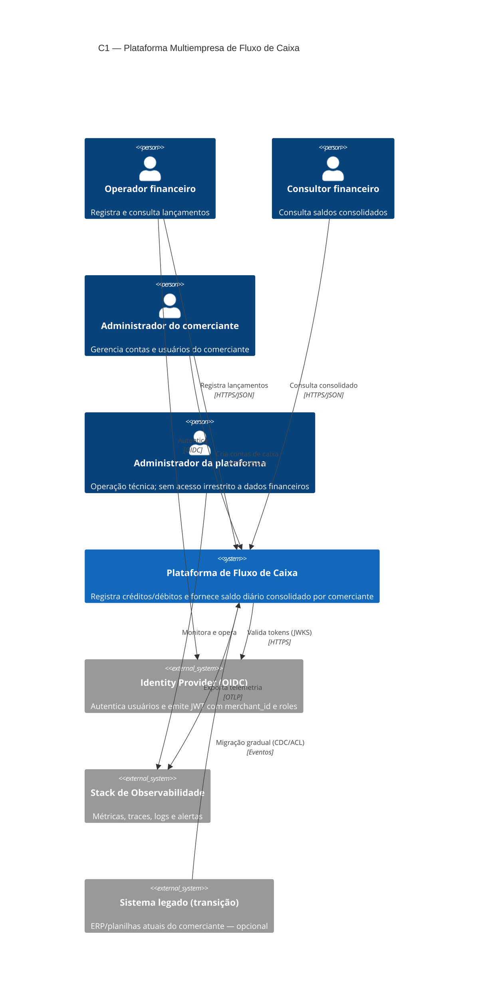
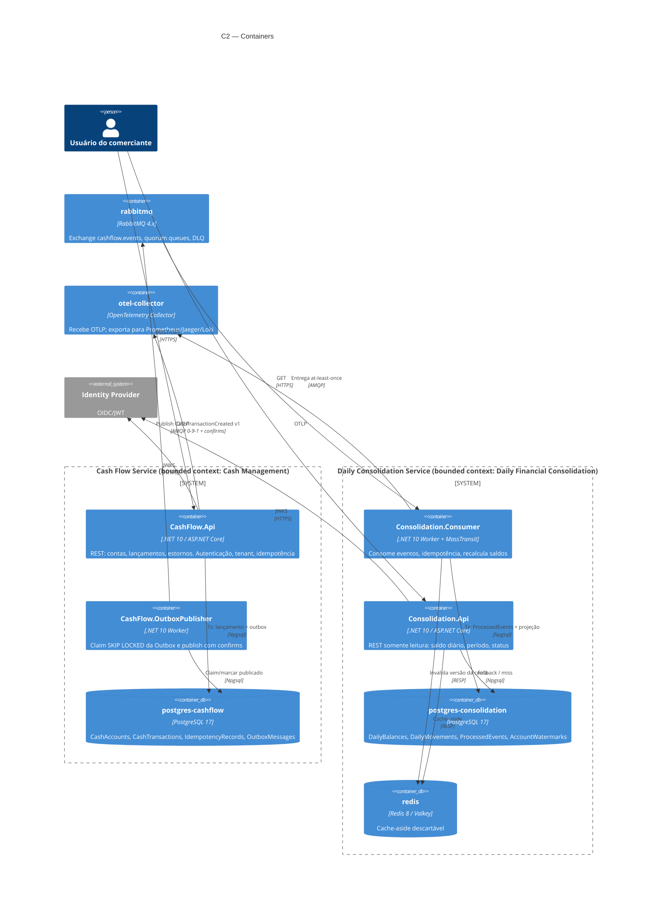
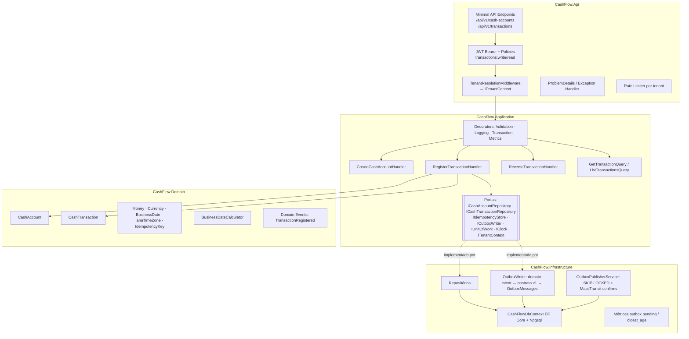
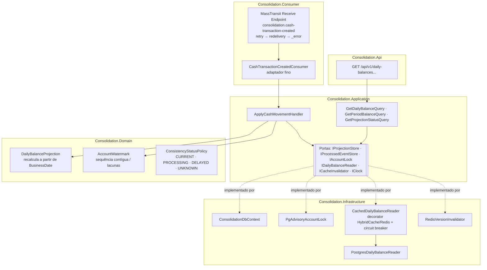

# Visão Geral — Modelo C4

> Diagramas em Mermaid (renderizam no GitHub). Níveis: **Contexto (C1)** → **Container (C2)** → **Componente (C3)**.

## C1 — Contexto do sistema

## C2 — Containers

### Responsabilidades e independência

| Container | Escala | Pode cair sem afetar a escrita? | Estado |
|---|---|---|---|
| CashFlow.Api | Horizontal (stateless) | — (é a escrita) | Nenhum (stateless) |
| CashFlow.OutboxPublisher | Horizontal (SKIP LOCKED) | ✅ Outbox acumula | Nenhum |
| postgres-cashflow | Vertical + standby HA | ❌ fonte da verdade | **Autoritativo** |
| rabbitmq | Cluster 3 nós (prod) | ✅ Outbox acumula | Durável (filas) |
| Consolidation.Consumer | Horizontal (lock por conta) | ✅ fila acumula | Nenhum |
| Consolidation.Api | Horizontal (stateless) | ✅ | Nenhum |
| postgres-consolidation | Vertical + réplica de leitura | ✅ | Projeção (reconstruível) |
| redis | Réplica | ✅ (e não afeta nem a leitura) | Descartável |

## C3 — Componentes do Cash Flow Service

## C3 — Componentes do Daily Consolidation Service

## Mapeamento contexto → container → dados

| Bounded context | Containers | Dados autoritativos | Dados derivados |
|---|---|---|---|
| Cash Management | CashFlow.Api, CashFlow.OutboxPublisher | CashAccounts, CashTransactions, IdempotencyRecords | OutboxMessages (transitório) |
| Daily Financial Consolidation | Consolidation.Consumer, Consolidation.Api | ProcessedEvents, AccountWatermarks | DailyMovements, DailyBalances, cache Redis |
| Identity & Access (externo) | IdP | Usuários, associações usuário-comerciante | Claims no JWT |
