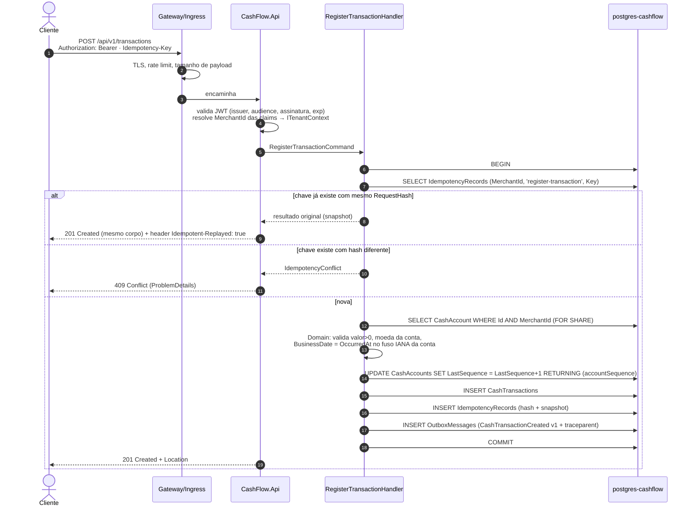
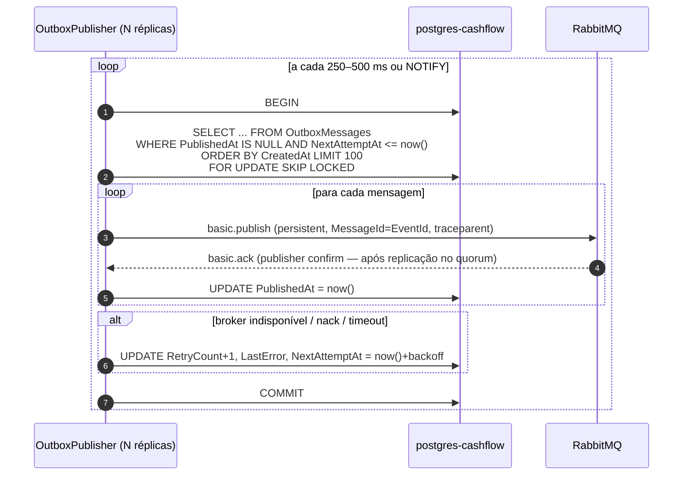
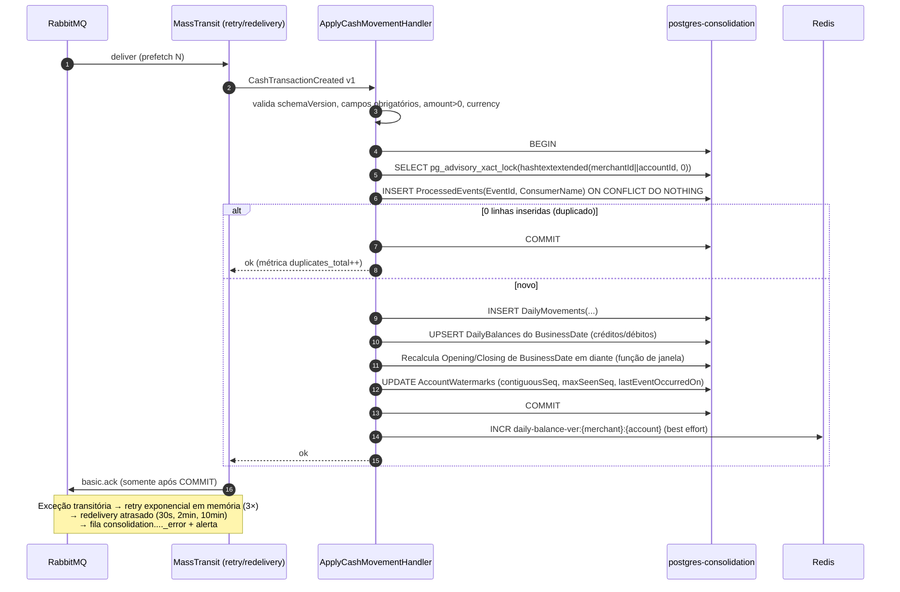
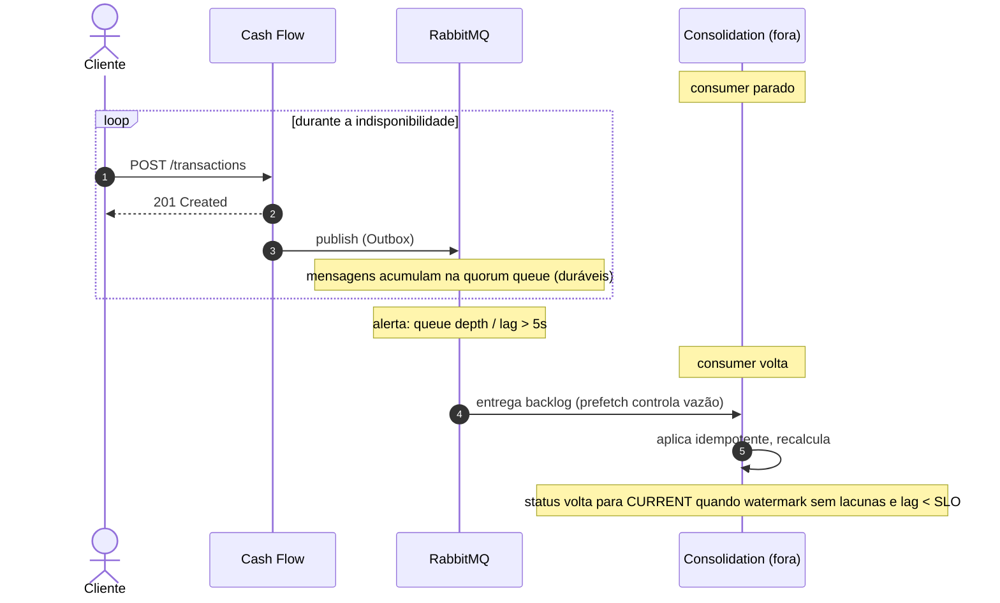
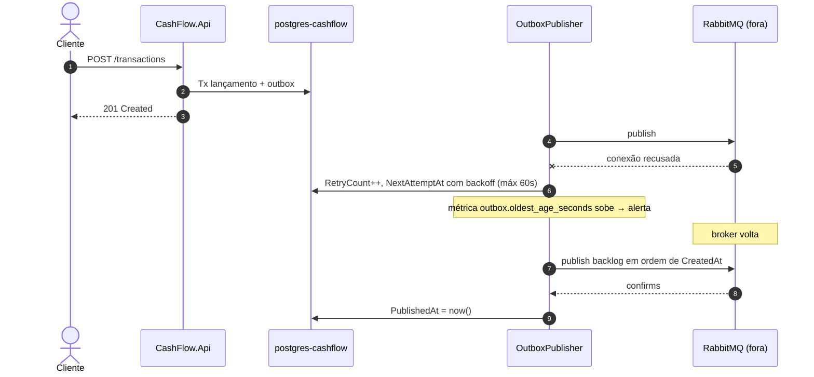

# Fluxos e Diagramas de Sequência

## 1. Fluxo de escrita — registrar lançamento



**Pontos de defesa:**
- RabbitMQ **não está** no caminho da resposta. O `201` depende só do PostgreSQL do Cash Flow.
- `INSERT` de transação e de Outbox são **atômicos**: ou ambos existem, ou nenhum.
- Concorrência de duas requisições com a mesma chave: a constraint `UNIQUE (MerchantId, Operation, IdempotencyKey)` faz a segunda falhar no commit; o handler captura a violação e devolve o resultado da primeira (ou `409`).
- A ordem de UPDATE em `CashAccounts` serializa escritas da mesma conta (row lock curto) e gera `accountSequence` sem lacunas, usada no watermark da consolidação.

## 2. Fluxo de publicação — Outbox Publisher



**Janela de duplicidade aceita:** se o worker cair entre o `ack` do broker e o `COMMIT`, a linha volta a ficar disponível e é republicada com o **mesmo `EventId`**. O consumidor deduplica. Isso é preferível à alternativa (marcar antes de publicar), que perderia eventos.

**Transação curta:** o lote é limitado (ex.: 100) e o timeout de publish é curto (ex.: 5 s) para não segurar locks. Alternativa equivalente: claim com `UPDATE ... SET LockedUntil = now()+30s ... RETURNING` fora de transação longa, e publicação sem transação aberta — recomendada se lotes maiores forem necessários (SPEC: "não manter transação aberta durante chamadas de rede").

## 3. Fluxo de consumo — consolidação idempotente



**Pontos de defesa:**
- **ACK depois do COMMIT** — crash entre os dois gera redelivery, absorvido por `ProcessedEvents`.
- **Advisory lock transacional** — liberado automaticamente no `COMMIT/ROLLBACK`; serializa a mesma conta entre réplicas, mantém paralelismo entre contas.
- **Invalidação do cache fora da transação e "best effort"** — se falhar, o TTL curto corrige; o cache nunca bloqueia a projeção.
- **Nenhuma chamada de rede com transação aberta** (Redis é chamado após o commit).

## 4. Fluxo de consulta

```mermaid
sequenceDiagram
    autonumber
    actor C as Cliente
    participant API as Consolidation.Api
    participant CR as CachedDailyBalanceReader
    participant R as Redis
    participant PG as PostgresDailyBalanceReader
    participant DB as postgres-consolidation

    C->>API: GET /api/v1/daily-balances?cashAccountId&from&to
    API->>API: JWT → MerchantId; valida período (≤ 366 dias)
    API->>CR: GetPeriod(merchant, account, from, to)
    CR->>R: GET ver + GET chave(versão)  [timeout 50ms, circuit breaker]
    alt hit
        R-->>CR: payload
    else miss
        CR->>PG: GetPeriod(...)
        PG->>DB: SELECT DailyBalances WHERE (MerchantId, AccountId, BusinessDate BETWEEN)
        PG->>DB: SELECT AccountWatermarks
        PG-->>CR: resultado + consistency
        CR->>R: SET chave EX 60 (best effort)
    else Redis indisponível (breaker aberto)
        CR->>PG: GetPeriod(...) direto
    end
    CR-->>API: resultado
    API-->>C: 200 OK { ..., consistency: { status, lastUpdatedAt, lagSeconds } }
```

## 5. Fluxo de estorno

```mermaid
sequenceDiagram
    autonumber
    actor C as Cliente
    participant API as CashFlow.Api
    participant D as Domain (CashTransaction)
    participant DB as postgres-cashflow

    C->>API: POST /api/v1/transactions/{id}/reversals (Idempotency-Key)
    API->>DB: BEGIN; SELECT original WHERE Id AND MerchantId FOR UPDATE
    alt não existe no tenant
        API-->>C: 404
    else já estornado / é um estorno
        API-->>C: 409 Conflict
    else
        API->>D: original.Reverse(reason, occurredAt) → nova transação tipo inverso
        API->>DB: INSERT CashTransactions (ReversesTransactionId = original)
        Note right of DB: índice único parcial em ReversesTransactionId<br/>garante estorno único mesmo com concorrência
        API->>DB: INSERT OutboxMessages (CashTransactionCreated v1, reversesTransactionId preenchido)
        API->>DB: COMMIT
        API-->>C: 201 Created
    end
```

## 6. Cenário de falha — consolidação indisponível (RNF-01 / RNF-10)



## 7. Cenário de falha — RabbitMQ indisponível


