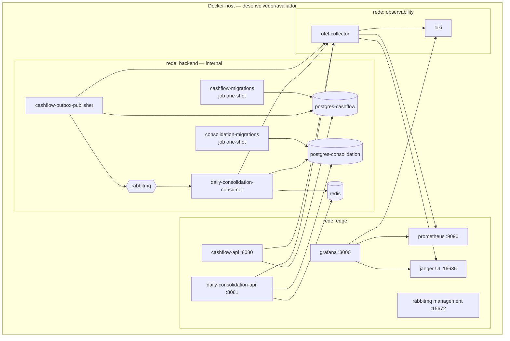
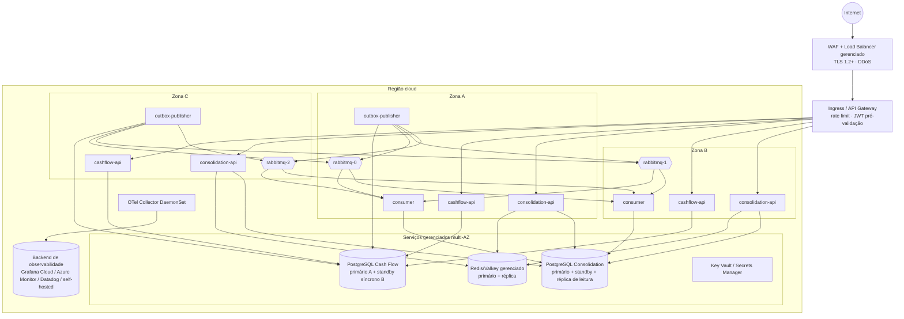

# Deployment e Alta Disponibilidade

Este documento descreve **dois ambientes**:

1. **Local / demonstração — Docker Compose** (escopo da v1, SPEC §17).
2. **Produção — arquitetura-alvo em Kubernetes gerenciado** (desenho; não implementado na v1, SPEC §2.1).

---

## 1. Ambiente local — Docker Compose



### Portas locais (definidas uma única vez no `docker-compose.yml`)

| Serviço | URL local | Observação |
|---|---|---|
| Cash Flow API | `http://localhost:8080/swagger` | OpenAPI + UI |
| Daily Consolidation API | `http://localhost:8081/swagger` | OpenAPI + UI |
| RabbitMQ Management | `http://localhost:15672` | Usuário de dev em `.env` |
| Grafana | `http://localhost:3000` | Dashboards provisionados |
| Jaeger | `http://localhost:16686` | Traces |
| Prometheus | `http://localhost:9090` | Métricas |
| PostgreSQL / Redis | não expostos por padrão | Expor só via `docker-compose.override.yml` para debug |

### Regras do Compose

- `depends_on: condition: service_healthy` para bancos, RabbitMQ e Redis; `condition: service_completed_successfully` para os jobs de migration.
- **Migrations em containers one-shot** (`dotnet ef migrations bundle` ou `efbundle`) — nunca no startup de réplicas.
- API e worker usam **a mesma imagem** com papel definido por variável (`ROLE=api|outbox-publisher|consumer`) ou imagens separadas — ambos atendem ao SPEC; separar containers permite parar só o consumer na demonstração.
- Volumes nomeados (`pgcf-data`, `pgdc-data`, `rabbitmq-data`) — dados sobrevivem a `docker compose down`; `down -v` apaga.
- Redes: `backend` marcada como `internal: true` (sem saída externa) para bancos/broker.
- Imagens multi-stage (`sdk` → `aspnet` chiseled/non-root), `USER app`, `HEALTHCHECK`.
- Segredos via `.env` (não versionado); `.env.example` versionado sem segredos reais.
- Limites de recursos (`deploy.resources.limits`) declarados para tornar o teste de carga reproduzível.

### Esqueleto ilustrativo do `docker-compose.yml`

```yaml
services:
  postgres-cashflow:
    image: postgres:17-alpine
    environment:
      POSTGRES_DB: cashflow
      POSTGRES_USER: ${CF_DB_USER}
      POSTGRES_PASSWORD: ${CF_DB_PASSWORD}
    volumes: [pgcf-data:/var/lib/postgresql/data]
    healthcheck:
      test: ["CMD-SHELL", "pg_isready -U $${POSTGRES_USER} -d cashflow"]
      interval: 5s
      retries: 10
    networks: [backend]

  rabbitmq:
    image: rabbitmq:4-management-alpine
    environment:
      RABBITMQ_DEFAULT_USER: ${RABBIT_USER}
      RABBITMQ_DEFAULT_PASS: ${RABBIT_PASSWORD}
      RABBITMQ_DEFAULT_VHOST: cashflow
    volumes:
      - rabbitmq-data:/var/lib/rabbitmq
      - ./deploy/rabbitmq/definitions.json:/etc/rabbitmq/definitions.json:ro
    healthcheck:
      test: ["CMD", "rabbitmq-diagnostics", "-q", "check_port_connectivity"]
      interval: 10s
      retries: 10
    ports: ["15672:15672"]
    networks: [backend, edge]

  cashflow-migrations:
    build: { context: ., dockerfile: deploy/docker/CashFlow.Migrations.Dockerfile }
    depends_on:
      postgres-cashflow: { condition: service_healthy }
    networks: [backend]
    restart: "no"

  cashflow-api:
    build: { context: ., dockerfile: deploy/docker/CashFlow.Api.Dockerfile }
    environment:
      ConnectionStrings__CashFlow: ${CF_DB_CONNECTION}
      OTEL_EXPORTER_OTLP_ENDPOINT: http://otel-collector:4317
      OTEL_SERVICE_NAME: cashflow-api
      Authentication__Mode: Development   # bloqueado se ASPNETCORE_ENVIRONMENT=Production
    depends_on:
      cashflow-migrations: { condition: service_completed_successfully }
    ports: ["8080:8080"]
    healthcheck:
      test: ["CMD", "curl", "-f", "http://localhost:8080/health/ready"]
    networks: [backend, edge, observability]
  # ... cashflow-outbox-publisher, daily-consolidation-*, redis, otel-collector, prometheus, grafana, jaeger, loki

networks:
  edge: {}
  backend: { internal: true }
  observability: {}

volumes:
  pgcf-data: {}
  pgdc-data: {}
  rabbitmq-data: {}
```

> O esqueleto é ilustrativo: versões de imagem devem ser verificadas e fixadas no momento da implementação (SPEC §15/§23).

### Limitações do Compose (assumidas e documentadas)

| Limitação | Consequência | Endereçado em produção por |
|---|---|---|
| Host único | Sem HA real; falha do host = falha total | Kubernetes multi-nó/multi-AZ |
| RabbitMQ nó único com classic/quorum de 1 réplica | Sem tolerância a perda de nó | Cluster 3 nós + quorum queues |
| PostgreSQL sem standby | Sem failover | Banco gerenciado com HA síncrono |
| Sem autoscaling | Capacidade fixa | HPA + KEDA |

---

## 2. Arquitetura-alvo de produção — Kubernetes gerenciado



### 2.1 Recursos Kubernetes por componente

| Componente | Recurso | Réplicas | Escala | Probes |
|---|---|---|---|---|
| cashflow-api | Deployment + Service + HPA + PDB | min 3 | HPA por CPU (60%) e RPS | live `/health/live`, ready `/health/ready` (DB) |
| cashflow-outbox-publisher | Deployment + PDB | 2 | Fixo (SKIP LOCKED permite N) | live; ready (DB + broker) |
| consolidation-consumer | Deployment + **KEDA ScaledObject** | min 2, max 10 | **Profundidade da fila RabbitMQ** | live; ready (DB + broker) |
| consolidation-api | Deployment + Service + HPA + PDB | min 3 | HPA por CPU / RPS | ready (DB; Redis **não** é crítico para readiness) |
| migrations | `Job` executado pelo pipeline antes do rollout | 1 | — | — |
| RabbitMQ | RabbitMQ Cluster Operator (`RabbitmqCluster`) ou gerenciado | 3 | — | Operator |
| OTel Collector | OpenTelemetry Operator (DaemonSet + gateway) | por nó | — | — |

> **Readiness da Consolidation API não depende do Redis.** Se dependesse, uma queda do cache tiraria todas as réplicas do balanceador — exatamente o oposto do que queremos.

### 2.2 Manifesto ilustrativo (consolidation-api)

```yaml
apiVersion: apps/v1
kind: Deployment
metadata:
  name: consolidation-api
spec:
  replicas: 3
  strategy:
    rollingUpdate: { maxUnavailable: 0, maxSurge: 1 }
  selector: { matchLabels: { app: consolidation-api } }
  template:
    metadata: { labels: { app: consolidation-api } }
    spec:
      securityContext: { runAsNonRoot: true, seccompProfile: { type: RuntimeDefault } }
      topologySpreadConstraints:
        - maxSkew: 1
          topologyKey: topology.kubernetes.io/zone
          whenUnsatisfiable: DoNotSchedule
          labelSelector: { matchLabels: { app: consolidation-api } }
      terminationGracePeriodSeconds: 30
      containers:
        - name: api
          image: registry.example/consolidation-api:1.0.0   # tag imutável/digest
          ports: [{ containerPort: 8080 }]
          envFrom:
            - configMapRef: { name: consolidation-config }
            - secretRef: { name: consolidation-secrets }   # via External Secrets
          resources:
            requests: { cpu: 250m, memory: 256Mi }
            limits: { memory: 512Mi }
          readinessProbe: { httpGet: { path: /health/ready, port: 8080 }, periodSeconds: 5 }
          livenessProbe: { httpGet: { path: /health/live, port: 8080 }, periodSeconds: 10 }
          securityContext:
            allowPrivilegeEscalation: false
            readOnlyRootFilesystem: true
            capabilities: { drop: ["ALL"] }
---
apiVersion: policy/v1
kind: PodDisruptionBudget
metadata: { name: consolidation-api }
spec:
  minAvailable: 2
  selector: { matchLabels: { app: consolidation-api } }
---
apiVersion: keda.sh/v1alpha1
kind: ScaledObject
metadata: { name: consolidation-consumer }
spec:
  scaleTargetRef: { name: consolidation-consumer }
  minReplicaCount: 2
  maxReplicaCount: 10
  triggers:
    - type: rabbitmq
      metadata:
        queueName: consolidation.cash-transaction-created
        mode: QueueLength
        value: "500"
      authenticationRef: { name: rabbitmq-trigger-auth }
```

### 2.3 Estratégia de deploy

- **CI**: restore → build → testes unitários → testes de integração (Testcontainers) → análise (analyzers, `dotnet list package --vulnerable`, Dependabot/Renovate, scan de imagem com Trivy) → build de imagem assinada (cosign) → push com tag imutável.
- **CD (GitOps — Argo CD/Flux)**: migration `Job` (mudanças de schema **expand/contract**, sempre compatíveis com a versão anterior) → rolling update com `maxUnavailable: 0` → verificação automática de SLO (taxa de erro, p95) → rollback automático se violado. Canary com Argo Rollouts como evolução.
- **Compatibilidade de eventos**: consumidores são implantados **antes** de produtores ao introduzir campos/versões novos (tolerant reader).

### 2.4 Topologia RabbitMQ para HA

| Item | Configuração |
|---|---|
| Nós | 3, um por zona (`podAntiAffinity` por zona) |
| Tipo de fila | **Quorum** (`x-queue-type: quorum`) — replicação Raft, tolera perda de 1 nó |
| Mensagens | `delivery_mode=2` (persistentes) |
| Publisher confirms | Habilitado; confirma após escrita na maioria |
| Delivery limit | `x-delivery-limit` (quorum) como proteção adicional contra *poison messages* |
| DLX | `cashflow.dlx` → filas `*.dlq` / `_error` do MassTransit |
| Vhost | `cashflow` dedicado; usuários por serviço com permissões mínimas |
| Partição de rede | `cluster_partition_handling = pause_minority` (classic) / Raft (quorum) |
| Recursos | Alarmes de memória/disco configurados; `max-length` + `overflow=reject-publish` em filas de não-críticas (não nas financeiras) |

### 2.5 PostgreSQL para HA

| Item | Cash Flow | Consolidation |
|---|---|---|
| HA | Standby **síncrono** em outra AZ (RPO 0) | Standby (assíncrono aceitável — projeção reconstruível) |
| Réplica de leitura | Opcional (listagens) | **Sim** — consultas da API podem ir para a réplica (com watermark para indicar defasagem) |
| Backup | Contínuo + **PITR** (retenção 35 dias) | Diário + PITR |
| Pooling | PgBouncer (transaction mode) — atenção: advisory locks **transacionais** são compatíveis; RLS com `SET LOCAL` também | idem |
| Conexões | `Maximum Pool Size` por réplica × réplicas < `max_connections` – reserva | idem |

### 2.6 Disaster Recovery (evolução)

| Nível | RPO | RTO | Custo | Quando |
|---|---|---|---|---|
| Backup cross-region (snapshots) | horas | horas | Baixo | v1 produção |
| Réplica cross-region do PostgreSQL Cash Flow (warm standby) | minutos | < 1 h | Médio | Requisito regulatório/contratual |
| Ativo-ativo multi-região | ~0 | minutos | Alto | Não recomendado sem necessidade clara (conflitos de escrita financeira) |

---

## 3. Alternativas de plataforma consideradas

| Plataforma | Prós | Contras | Recomendação |
|---|---|---|---|
| **Kubernetes gerenciado (AKS/EKS/GKE)** | Padrão de mercado, portável, KEDA, operadores (RabbitMQ, OTel), GitOps | Exige competência de plataforma; custo de control plane e nós | **Alvo** se a organização já opera K8s |
| Azure Container Apps / Google Cloud Run / AWS ECS Fargate | Menos operação, autoscaling (ACA tem KEDA nativo), pay-per-use | Menos controle; dependência de cloud | **Alvo alternativo** para time sem plataforma |
| VMs + Docker Compose | Simples | Sem HA/autoscaling/self-healing | Somente dev/demo |
| Serverless functions | Escala a zero | Cold start, conexões a PG, limites de execução, Outbox menos natural | Não recomendado para este domínio |
