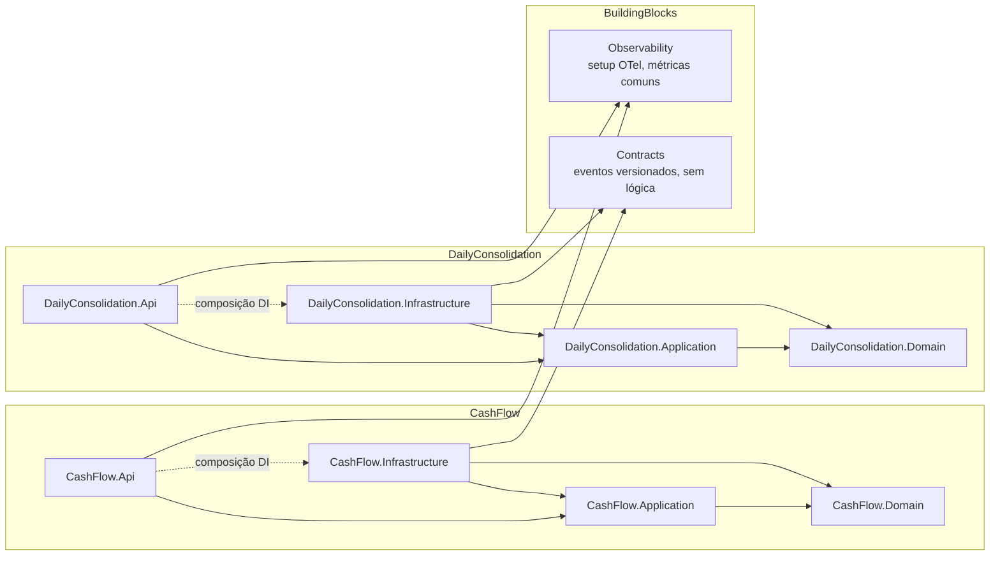

# SOLID, Clean Architecture e DDD Tático

## 1. Estrutura de projetos e regra de dependência



| Regra | Como é garantida |
|---|---|
| Domain não referencia nenhum projeto nem pacote de infraestrutura | `.csproj` sem `PackageReference` de EF/MassTransit; **teste de arquitetura** (NetArchTest/ArchUnitNET) falha o build |
| Application referencia só Domain | Teste de arquitetura |
| Contratos de integração ≠ entidades de domínio | `BuildingBlocks.Contracts` contém apenas `record`s de eventos; nenhuma entidade é compartilhada entre serviços |
| Api não acessa DbContext diretamente | Teste de arquitetura; Api conversa só com handlers de Application |

### Estrutura de pastas por serviço (Cash Flow)

```text
CashFlow.Domain/
  Accounts/        CashAccount.cs, CashAccountStatus.cs
  Transactions/    CashTransaction.cs, TransactionType.cs, TransactionRegistered.cs
  Shared/          Money.cs, Currency.cs, BusinessDate.cs, IanaTimeZone.cs, MerchantId.cs
  Services/        BusinessDateCalculator.cs
  Errors/          DomainError.cs, Result.cs
CashFlow.Application/
  Abstractions/    ICommandHandler.cs, IQueryHandler.cs, ITenantContext.cs, IClock.cs, IUnitOfWork.cs
  Ports/           ICashAccountRepository.cs, ICashTransactionRepository.cs, IIdempotencyStore.cs, IOutboxWriter.cs
  Transactions/    RegisterTransaction/ (Command, Handler, Validator), ReverseTransaction/, ListTransactions/
  Accounts/        CreateCashAccount/
  Behaviors/       ValidationDecorator.cs, TransactionDecorator.cs, LoggingDecorator.cs, MetricsDecorator.cs
CashFlow.Infrastructure/
  Persistence/     CashFlowDbContext.cs, Configurations/, Migrations/, Repositories/
  Outbox/          OutboxWriter.cs, OutboxPublisherService.cs, OutboxClaimer.cs, OutboxMetrics.cs
  Messaging/       MassTransitIntegrationEventPublisher.cs, BusConfiguration.cs
  Tenancy/         RlsConnectionInterceptor.cs
CashFlow.Api/
  Endpoints/       CashAccountsEndpoints.cs, TransactionsEndpoints.cs
  Auth/            TenantResolutionMiddleware.cs, Policies.cs, DevelopmentAuthHandler.cs
  ErrorHandling/   ProblemDetailsMapping.cs
  Program.cs
```

---

## 2. SOLID — aplicação concreta

> Objetivo: mostrar que cada princípio resolve um problema **deste** sistema, não aplicar padrões por padrão.

### S — Single Responsibility Principle

**Problema:** um "TransactionService" que valida, calcula data, grava, cuida de idempotência, publica no RabbitMQ e loga vira um ponto único de mudança e de bugs.

**Aplicação:** cada classe tem **um motivo para mudar**.

| Classe | Única responsabilidade | Muda quando… |
|---|---|---|
| `RegisterTransactionHandler` | Orquestrar o caso de uso | O fluxo do caso de uso muda |
| `CashTransaction` (agregado) | Garantir invariantes do lançamento | Regra de negócio muda |
| `BusinessDateCalculator` | Converter `OccurredAt` para data operacional no fuso IANA | Regra de calendário muda |
| `IdempotencyGuard` | Hash do request, detecção de replay/conflito | Política de idempotência muda |
| `OutboxWriter` | Mapear evento de domínio → contrato v1 → linha Outbox | Contrato de integração muda |
| `OutboxPublisherService` | Claim, publish com confirm, marcação | Estratégia de publicação muda |

```csharp
public sealed class BusinessDateCalculator
{
    public BusinessDate Calculate(DateTimeOffset occurredAt, IanaTimeZone zone)
    {
        var tz = TimeZoneInfo.FindSystemTimeZoneById(zone.Value); // IANA suportado nativamente no .NET (ICU)
        var local = TimeZoneInfo.ConvertTime(occurredAt, tz);
        return new BusinessDate(DateOnly.FromDateTime(local.DateTime));
    }
}
```

### O — Open/Closed Principle

**Problema:** adicionar validação, transação, métricas ou logging a todos os casos de uso sem editar cada handler.

**Aplicação:** **decorators** sobre `ICommandHandler<TCommand, TResult>` registrados por DI (Scrutor `Decorate` ou registro manual). Novo comportamento transversal = nova classe, nenhum handler alterado. **Sem MediatR** (licença comercial a partir da v13) — a abstração é pequena e própria.

```csharp
public interface ICommandHandler<in TCommand, TResult>
{
    Task<Result<TResult>> Handle(TCommand command, CancellationToken ct);
}

public sealed class TransactionDecorator<TCommand, TResult>(
    ICommandHandler<TCommand, TResult> inner, IUnitOfWork uow)
    : ICommandHandler<TCommand, TResult>
{
    public async Task<Result<TResult>> Handle(TCommand command, CancellationToken ct)
    {
        await using var tx = await uow.BeginAsync(ct);
        var result = await inner.Handle(command, ct);
        if (result.IsSuccess) await tx.CommitAsync(ct);
        return result;
    }
}
// Registro: Validation → Logging → Metrics → Transaction → Handler
```

Outro exemplo: `IConsistencyStatusPolicy` permite trocar a regra de cálculo de `CURRENT/DELAYED` (ex.: SLO por plano do cliente) sem alterar a API.

### L — Liskov Substitution Principle

**Problema:** um decorator de cache que muda a semântica (ex.: retorna `null` em erro do Redis em vez do saldo) quebra o contrato silenciosamente.

**Aplicação:** `CachedDailyBalanceReader` e `PostgresDailyBalanceReader` implementam `IDailyBalanceReader` com **o mesmo contrato observável**: mesmo resultado, mesmas exceções de domínio, mesmo isolamento por tenant. O cache só altera latência.

```csharp
public sealed class CachedDailyBalanceReader(
    IDailyBalanceReader inner, HybridCache cache, ICacheKeyStrategy keys)
    : IDailyBalanceReader
{
    public async Task<PeriodBalance> GetPeriod(PeriodQuery q, CancellationToken ct)
    {
        var key = await keys.ForPeriod(q, ct);  // inclui merchantId + versão da conta
        try
        {
            return await cache.GetOrCreateAsync(key,
                async token => await inner.GetPeriod(q, token),
                CacheOptions.ShortLived, cancellationToken: ct);
        }
        catch (Exception ex) when (ex is RedisException or BrokenCircuitException or TimeoutException)
        {
            return await inner.GetPeriod(q, ct); // degrada para PG — mesmo contrato
        }
    }
}
```

Testes de contrato rodam **a mesma suíte** contra as duas implementações para provar a substituibilidade.

### I — Interface Segregation Principle

**Problema:** uma interface `IOutbox` com `Add`, `Claim`, `MarkPublished`, `MarkFailed` obriga a Application a conhecer detalhes do worker.

**Aplicação:** interfaces pequenas por **cliente**:

| Interface | Cliente | Métodos |
|---|---|---|
| `IOutboxWriter` | Application (handlers) | `Enqueue(IntegrationEvent)` |
| `IOutboxClaimer` | Só o worker | `ClaimBatch`, `MarkPublished`, `MarkFailed` |
| `ITenantContext` | Handlers/repositórios | `MerchantId`, `UserId` |
| `IDailyBalanceReader` | Queries | `GetDay`, `GetPeriod` |
| `IProjectionStore` | Handler de consumo | `ApplyMovement`, `RecalculateFrom` |
| `ICacheInvalidator` | Handler de consumo | `InvalidateAccount` |

### D — Dependency Inversion Principle

**Problema:** se a Application depender de MassTransit, EF Core ou StackExchange.Redis, a troca de qualquer um (cenário real: licença do MassTransit v9) contamina regras de negócio.

**Aplicação:** a Application **declara** as portas; a Infrastructure **implementa**; a Api **compõe**.

```csharp
// Application (porta)
public interface IIntegrationEventPublisher
{
    Task Publish(OutboxEnvelope envelope, CancellationToken ct);
}

// Infrastructure (adaptador) — único lugar que conhece MassTransit
public sealed class MassTransitIntegrationEventPublisher(IPublishEndpoint bus) : IIntegrationEventPublisher
{
    public Task Publish(OutboxEnvelope e, CancellationToken ct) =>
        bus.Publish(e.ToContract(), ctx =>
        {
            ctx.MessageId = e.EventId;
            ctx.CorrelationId = e.CorrelationId;
            ctx.Headers.Set("traceparent", e.TraceParent);
            ctx.Durable = true;
        }, ct);
}
```

Trocar por Wolverine, Rebus ou `RabbitMQ.Client` = novo adaptador + registro de DI. Domínio e Application intactos.

---

## 3. DDD tático

### Agregados e invariantes

| Agregado | Invariantes |
|---|---|
| `CashAccount` | Pertence a um único `MerchantId`; moeda única e imutável (ISO 4217); fuso IANA válido; status `Active` para aceitar lançamentos |
| `CashTransaction` | `Amount > 0`; `Type ∈ {CREDIT, DEBIT, OPENING_BALANCE}`; moeda = moeda da conta; imutável após criação; estorno gera **nova** transação inversa e só pode ocorrer uma vez; estorno não pode ser estornado (v1) |
| `DailyBalanceProjection` (Consolidation) | `Closing = Opening + Credits − Debits`; `Opening(d) = Closing(d−1)`; primeiro dia usa abertura |

### Value Objects

```csharp
public readonly record struct Money
{
    public decimal Amount { get; }
    public Currency Currency { get; }

    public Money(decimal amount, Currency currency)
    {
        if (amount <= 0) throw new DomainException("amount.must_be_positive");
        if (decimal.Round(amount, 4) != amount) throw new DomainException("amount.max_4_decimals");
        Amount = amount;
        Currency = currency;
    }
}
```

- `decimal` no .NET, `NUMERIC(19,4)` no PostgreSQL. Nunca `float/double`. Serialização JSON de `decimal` como número com precisão preservada (System.Text.Json preserva `decimal`).
- `Currency` validada contra ISO 4217; v1 aceita apenas `BRL`, mas persiste o código.

### Fábrica com resultado explícito (sem exceções para fluxo de negócio)

```csharp
public static Result<CashTransaction> Register(
    CashAccount account, TransactionType type, Money amount, string? description,
    DateTimeOffset occurredAt, BusinessDateCalculator calc, IClock clock)
{
    if (!account.IsActive) return DomainErrors.AccountInactive;
    if (amount.Currency != account.Currency) return DomainErrors.CurrencyMismatch;
    var businessDate = calc.Calculate(occurredAt, account.TimeZone);
    return new CashTransaction(Guid.CreateVersion7(), account.MerchantId, account.Id, type,
        amount, description, occurredAt, businessDate, clock.UtcNow);
}
```

> `Guid.CreateVersion7()` (.NET 9+) gera UUIDs ordenáveis por tempo, bons para índices B-tree. **A consolidação não assume ordem pelo UUID** (SPEC §10.2) — usa `accountSequence`.

---

## 4. Outras boas práticas aplicadas

| Prática | Aplicação |
|---|---|
| **Result pattern** | Erros de negócio retornam `Result` → mapeados para ProblemDetails (`400/404/409/422`); exceções ficam para o inesperado (`500`) |
| **Validação em camadas** | Sintática no endpoint (tamanhos, formatos), semântica no domínio (invariantes), referencial no banco (FK composta, unique) |
| **Configuração tipada** | `IOptions<T>` com `ValidateDataAnnotations().ValidateOnStart()` — falha cedo |
| **CancellationToken ponta a ponta** | Requests cancelados liberam conexões |
| **Nullable reference types + warnings as errors** | `Directory.Build.props` |
| **Central Package Management** | `Directory.Packages.props` com versões fixas |
| **Testes de arquitetura** | Garantem a regra de dependência no CI |
| **Tempo injetável** | `TimeProvider` (.NET 8+) em vez de `DateTime.UtcNow` — testes determinísticos de fuso/data |
| **Sem lógica em controllers** | Endpoints só mapeiam HTTP ↔ comando/consulta |
| **Logs estruturados** | `ILogger` com *message templates* e `LoggerMessage` source generator; sem payload financeiro completo |
