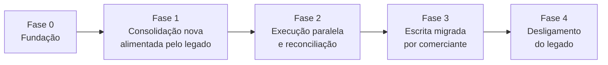
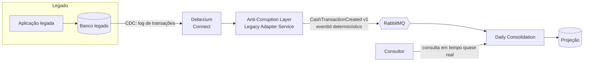
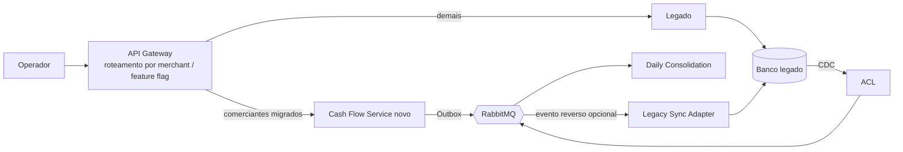

# Arquitetura de Transição — Migração de Legado

> **Requisito diferencial do desafio.** Como o enunciado não descreve o legado, adotamos uma **premissa explícita** e desenhamos a migração a partir dela. Se a realidade for diferente, o padrão (Strangler Fig + Anti-Corruption Layer + execução paralela com reconciliação) continua válido.

## 1. Premissa do cenário legado

- Um **sistema monolítico** (ERP/aplicação desktop ou web antiga) com banco relacional (ex.: SQL Server/Oracle) onde os comerciantes já registram lançamentos.
- O **saldo diário** é gerado por **job batch noturno** (D+1), muitas vezes com relatórios lentos e consultas pesadas no banco transacional.
- Integrações por arquivo (CSV) com contabilidade.
- Não é possível desligar o legado de uma vez (*big bang*): risco financeiro e operacional inaceitável.

## 2. Estratégia: Strangler Fig em 4 fases

### Fase 0 — Fundação
- Plataforma (cluster/PaaS, RabbitMQ, PostgreSQL, observabilidade, IdP) provisionada via IaC.
- Contrato canônico `CashTransactionCreated v1` publicado e versionado.
- Catálogo de comerciantes e contas sincronizado (mapeamento `LegacyAccountId ↔ CashAccountId`).

### Fase 1 — Consolidação nova alimentada pelo legado (ganho rápido, risco baixo)

O **Daily Consolidation Service** entra primeiro, porque é **leitura derivada** — se algo der errado, o legado continua sendo a referência.

- **CDC (Debezium)** lê o log do banco legado sem alterar o sistema antigo (sem triggers, sem tocar código).
- **Anti-Corruption Layer (ACL)** traduz o modelo legado (códigos, sinais negativos para débito, datas locais sem fuso, `float`) para o **contrato canônico**:
  - `eventId` **determinístico** = UUIDv5(namespace, `legacyTable + legacyPk + operation`) → reprocessar o CDC não duplica efeito.
  - Conversão de valores para `decimal` com regra de arredondamento documentada.
  - Cálculo de `businessDate` com o fuso do comerciante.
  - Atualizações/exclusões no legado (que violam imutabilidade) viram **estornos + novo lançamento** no modelo novo.
- Benefício imediato: consolidado em segundos em vez de D+1, e consultas saem do banco legado.

### Fase 2 — Execução paralela e reconciliação

- Legado e plataforma nova calculam o saldo diário **em paralelo**.
- **Job de reconciliação diária** compara, por comerciante/conta/dia, `TotalCredits`, `TotalDebits` e `ClosingBalance`. Divergências geram alerta e relatório.
- Critério de saída: N dias consecutivos (ex.: 30) com **divergência zero** em 100% das contas migráveis.

### Fase 3 — Escrita migrada por comerciante (canário)

- Migração **por comerciante** (feature flag no gateway): começa com comerciantes internos/piloto, depois por ondas (1% → 10% → 50% → 100%).
- Para o comerciante migrado, o **Cash Flow novo é a fonte da verdade**. Se outros sistemas ainda dependem do banco legado (contabilidade, relatórios), um **Legacy Sync Adapter** consome eventos e grava no legado (sincronização reversa, idempotente).
- **Saldo de abertura** do comerciante migrado é carregado como lançamento `OPENING_BALANCE` auditável, com data de corte.
- **Rollback**: desligar a flag devolve o comerciante ao legado; como o sync reverso manteve o legado atualizado, não há perda.

### Fase 4 — Desligamento
- Sem tráfego no legado por período acordado; dados históricos exportados para arquivo/consulta somente leitura.
- Remoção do CDC, do ACL e do sync reverso. Legado desativado.

## 3. Riscos da transição

| Risco | Mitigação |
|---|---|
| Divergência de regras (arredondamento, fuso, sinais) | ACL com testes de contrato baseados em amostras reais; reconciliação diária |
| Edições/exclusões no legado | ACL converte em estorno + novo lançamento; alerta para volume anômalo |
| Duplicidade em reprocessamento do CDC | `eventId` determinístico + consumidor idempotente |
| Duas fontes da verdade simultâneas para o mesmo comerciante | Roteamento exclusivo por comerciante (nunca dividido por operação) |
| Carga do CDC no banco legado | Debezium lê o log (não faz queries pesadas); snapshot inicial fora do horário comercial |
| Necessidade do Kafka para o Debezium | Usar **Debezium Server** com sink RabbitMQ (sem Kafka) ou Kafka Connect temporário, removido na Fase 4 |

## 4. Por que não big bang?

| Critério | Big bang | **Strangler Fig** |
|---|---|---|
| Risco financeiro | Alto (tudo de uma vez) | Baixo (por comerciante, reversível) |
| Feedback | Só no final | Contínuo (reconciliação diária) |
| Rollback | Difícil/caro | Flag por comerciante |
| Valor entregue cedo | Não | Sim (consolidado em segundos já na Fase 1) |
| Custo | Menor no papel | Maior (infra paralela temporária), compensado pela redução de risco |
