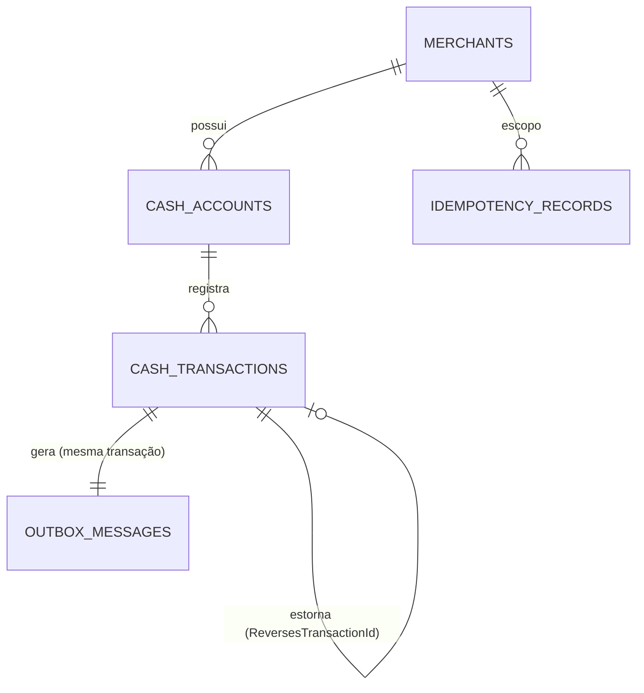
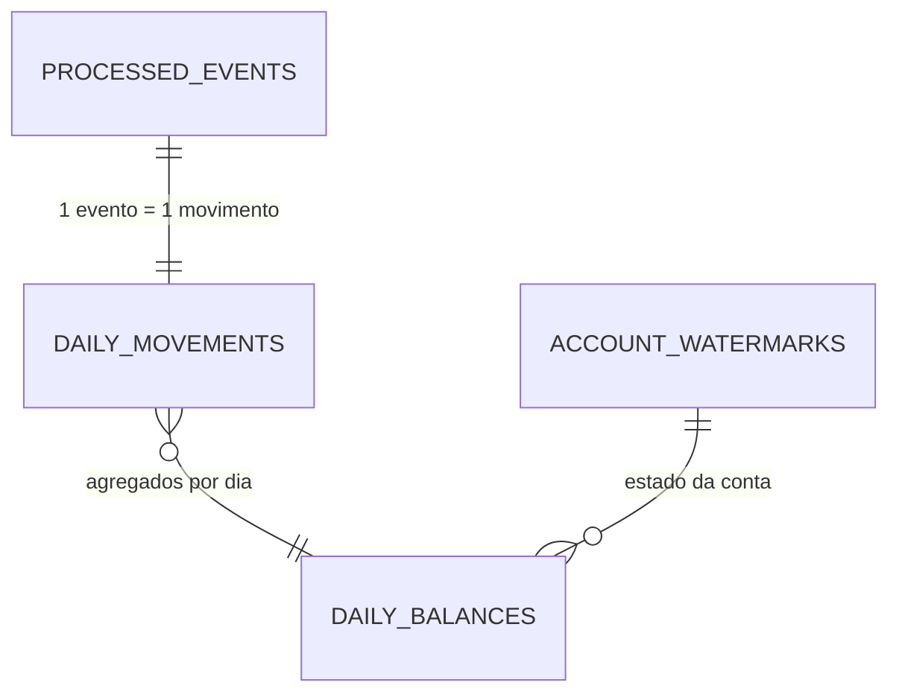

# Modelo de Dados

> DDL ilustrativa (PostgreSQL 17). Na implementação, o schema é gerado por **migrations EF Core versionadas**; a DDL abaixo documenta a intenção e as constraints que **devem** existir.

## 1. Cash Flow (`postgres-cashflow`)



```sql
CREATE TABLE merchants (
    id          uuid PRIMARY KEY,
    name        varchar(200) NOT NULL,
    time_zone   varchar(100) NOT NULL,
    status      varchar(30)  NOT NULL,
    created_at  timestamptz  NOT NULL
);

CREATE TABLE cash_accounts (
    id            uuid PRIMARY KEY,
    merchant_id   uuid NOT NULL REFERENCES merchants(id),
    name          varchar(150) NOT NULL,
    currency      char(3)      NOT NULL CHECK (currency ~ '^[A-Z]{3}$'),
    time_zone     varchar(100) NOT NULL,
    status        varchar(30)  NOT NULL,
    last_sequence bigint       NOT NULL DEFAULT 0,      -- gera accountSequence para o watermark
    created_at    timestamptz  NOT NULL,
    CONSTRAINT uq_cash_accounts_merchant_id UNIQUE (merchant_id, id)   -- alvo da FK composta
);

CREATE TABLE cash_transactions (
    id                      uuid PRIMARY KEY,
    merchant_id             uuid          NOT NULL,
    cash_account_id         uuid          NOT NULL,
    type                    varchar(30)   NOT NULL CHECK (type IN ('CREDIT','DEBIT','OPENING_BALANCE')),
    amount                  numeric(19,4) NOT NULL CHECK (amount > 0),
    currency                char(3)       NOT NULL,
    description             varchar(500),
    occurred_at             timestamptz   NOT NULL,
    business_date           date          NOT NULL,
    created_at              timestamptz   NOT NULL,
    account_sequence        bigint        NOT NULL,
    idempotency_key         varchar(200)  NOT NULL,
    reverses_transaction_id uuid          NULL,
    -- FK composta: impossível lançar em conta de outro comerciante
    CONSTRAINT fk_tx_account FOREIGN KEY (merchant_id, cash_account_id)
        REFERENCES cash_accounts (merchant_id, id),
    CONSTRAINT fk_tx_reverses FOREIGN KEY (reverses_transaction_id)
        REFERENCES cash_transactions (id),
    CONSTRAINT uq_tx_account_seq UNIQUE (cash_account_id, account_sequence)
);

-- Um único estorno integral por transação original (v1)
CREATE UNIQUE INDEX uq_tx_single_reversal
    ON cash_transactions (reverses_transaction_id)
    WHERE reverses_transaction_id IS NOT NULL;

CREATE INDEX ix_tx_listing  ON cash_transactions (merchant_id, cash_account_id, occurred_at, id);
CREATE INDEX ix_tx_bizdate  ON cash_transactions (merchant_id, cash_account_id, business_date);

-- Imutabilidade reforçada no banco: o usuário da aplicação não tem UPDATE/DELETE
REVOKE UPDATE, DELETE ON cash_transactions FROM cashflow_app;

CREATE TABLE idempotency_records (
    merchant_id       uuid         NOT NULL,
    operation         varchar(100) NOT NULL,   -- 'register-transaction' | 'reverse-transaction' | 'create-account'
    idempotency_key   varchar(200) NOT NULL,
    request_hash      char(64)     NOT NULL,   -- SHA-256 do payload canonicalizado
    resource_id       uuid         NOT NULL,
    response_status   int          NOT NULL,
    response_snapshot jsonb        NULL,
    created_at        timestamptz  NOT NULL,
    PRIMARY KEY (merchant_id, operation, idempotency_key)
);
-- Retenção: permanente na v1 (SPEC §10.1). Revisar com a janela de risco do negócio.

CREATE TABLE outbox_messages (
    id              uuid PRIMARY KEY,           -- = eventId
    event_type      varchar(200) NOT NULL,
    schema_version  int          NOT NULL,
    payload         jsonb        NOT NULL,
    trace_parent    varchar(55)  NULL,          -- W3C trace context para trace ponta a ponta
    created_at      timestamptz  NOT NULL,
    published_at    timestamptz  NULL,
    retry_count     int          NOT NULL DEFAULT 0,
    next_attempt_at timestamptz  NOT NULL,
    last_error      text         NULL
);

CREATE INDEX ix_outbox_pending
    ON outbox_messages (next_attempt_at, created_at)
    WHERE published_at IS NULL;
```

**Claim concorrente seguro:**

```sql
SELECT id, event_type, schema_version, payload, trace_parent
FROM outbox_messages
WHERE published_at IS NULL AND next_attempt_at <= now()
ORDER BY created_at
LIMIT 100
FOR UPDATE SKIP LOCKED;
```

**Retenção da Outbox:** mensagens publicadas são removidas/arquivadas por job após N dias (ex.: 7), mantendo histórico suficiente para auditoria operacional. A republicação para reconstrução usa `cash_transactions` (fonte da verdade), não a Outbox.

### Row-Level Security (defesa em profundidade)

```sql
ALTER TABLE cash_transactions ENABLE ROW LEVEL SECURITY;
CREATE POLICY tenant_isolation ON cash_transactions
    USING (merchant_id = current_setting('app.merchant_id')::uuid);
-- A aplicação executa SET LOCAL app.merchant_id = '<tenant>' no início de cada transação
-- (interceptor do EF Core). SET LOCAL é descartado no fim da transação → seguro com pooling.
-- Worker da Outbox usa um papel de banco distinto com BYPASSRLS restrito à tabela outbox_messages.
```

---

## 2. Daily Consolidation (`postgres-consolidation`)



```sql
CREATE TABLE processed_events (
    event_id      uuid         NOT NULL,
    consumer_name varchar(150) NOT NULL,
    processed_at  timestamptz  NOT NULL,
    PRIMARY KEY (event_id, consumer_name)
);

-- Registro dos movimentos aplicados: permite reconstrução determinística
-- da projeção sem acessar o banco do produtor (SPEC §10.2)
CREATE TABLE daily_movements (
    event_id                uuid          PRIMARY KEY,
    merchant_id             uuid          NOT NULL,
    cash_account_id         uuid          NOT NULL,
    transaction_id          uuid          NOT NULL UNIQUE,
    business_date           date          NOT NULL,
    currency                char(3)       NOT NULL,
    transaction_type        varchar(30)   NOT NULL,
    amount                  numeric(19,4) NOT NULL CHECK (amount > 0),
    reverses_transaction_id uuid          NULL,
    account_sequence        bigint        NULL,
    occurred_on             timestamptz   NOT NULL,
    applied_at              timestamptz   NOT NULL
);
CREATE INDEX ix_mov_account_date ON daily_movements (merchant_id, cash_account_id, currency, business_date);

CREATE TABLE daily_balances (
    merchant_id      uuid          NOT NULL,
    cash_account_id  uuid          NOT NULL,
    business_date    date          NOT NULL,
    currency         char(3)       NOT NULL,
    opening_balance  numeric(19,4) NOT NULL,
    total_credits    numeric(19,4) NOT NULL,
    total_debits     numeric(19,4) NOT NULL,
    closing_balance  numeric(19,4) NOT NULL,
    updated_at       timestamptz   NOT NULL,
    PRIMARY KEY (merchant_id, cash_account_id, business_date, currency),
    CHECK (closing_balance = opening_balance + total_credits - total_debits)
);

CREATE TABLE account_watermarks (
    merchant_id              uuid        NOT NULL,
    cash_account_id          uuid        NOT NULL,
    contiguous_sequence      bigint      NOT NULL DEFAULT 0,  -- maior seq sem lacunas aplicada
    max_seen_sequence        bigint      NOT NULL DEFAULT 0,
    last_event_occurred_on   timestamptz NULL,               -- para lag
    last_applied_at          timestamptz NULL,
    PRIMARY KEY (merchant_id, cash_account_id)
);
```

### Regras de mapeamento do evento para o movimento

| `transactionType` | Efeito |
|---|---|
| `CREDIT` | soma em `total_credits` |
| `DEBIT` | soma em `total_debits` |
| `OPENING_BALANCE` | soma em `total_credits` do dia de abertura (saldo inicial auditável — regra 12) |
| Estorno (`reversesTransactionId` ≠ null) | já chega com tipo invertido → tratado como lançamento comum |

### Recálculo a partir de uma data (evento retroativo ou fora de ordem)

Executado **dentro da transação do consumer**, após o advisory lock da conta:

```sql
WITH prev AS (
    SELECT closing_balance
    FROM daily_balances
    WHERE merchant_id = @m AND cash_account_id = @a AND currency = @c AND business_date < @d
    ORDER BY business_date DESC
    LIMIT 1
),
days AS (
    SELECT business_date,
           SUM(amount) FILTER (WHERE transaction_type IN ('CREDIT','OPENING_BALANCE')) AS credits,
           SUM(amount) FILTER (WHERE transaction_type = 'DEBIT')                       AS debits
    FROM daily_movements
    WHERE merchant_id = @m AND cash_account_id = @a AND currency = @c AND business_date >= @d
    GROUP BY business_date
),
calc AS (
    SELECT business_date,
           COALESCE(credits,0) AS credits,
           COALESCE(debits,0)  AS debits,
           COALESCE((SELECT closing_balance FROM prev), 0)
             + SUM(COALESCE(credits,0) - COALESCE(debits,0)) OVER (ORDER BY business_date) AS closing
    FROM days
)
INSERT INTO daily_balances AS b (merchant_id, cash_account_id, business_date, currency,
                                 opening_balance, total_credits, total_debits, closing_balance, updated_at)
SELECT @m, @a, business_date, @c, closing - credits + debits, credits, debits, closing, now()
FROM calc
ON CONFLICT (merchant_id, cash_account_id, business_date, currency) DO UPDATE
SET opening_balance = EXCLUDED.opening_balance,
    total_credits   = EXCLUDED.total_credits,
    total_debits    = EXCLUDED.total_debits,
    closing_balance = EXCLUDED.closing_balance,
    updated_at      = EXCLUDED.updated_at;
```

- **Dias sem movimento** não são materializados; a API preenche lacunas no período com `opening = closing = closing do último dia anterior`, créditos/débitos zero (regra 14).
- Custo: O(dias com movimento a partir de `@d`) por evento retroativo. Medido pela métrica `consolidation.recalculated_days`. Otimização futura: snapshots mensais ou recálculo em lote com *debounce* por conta.

### Cálculo do status de consistência

```text
se watermark inexistente ou consumer sem heartbeat recente  → UNKNOWN
senão se max_seen_sequence > contiguous_sequence             → PROCESSING   (lacuna conhecida)
senão se now() - last_event_occurred_on > SLO (5 s) e há
         eventos pendentes conhecidos (outbox/fila)           → DELAYED
senão                                                         → CURRENT
lagSeconds = last_applied_at - last_event_occurred_on (do último evento aplicado)
```

> Lacunas "invisíveis" (evento ainda não chegou e nenhum posterior chegou) são detectadas por métrica operacional (`outbox.oldest_age_seconds` e profundidade de fila), e a API pode reportar `PROCESSING` com base em um *heartbeat* publicado pelo Outbox Publisher com a maior sequência publicada por conta (evolução).

## 3. Chaves Redis

| Chave | Conteúdo | TTL |
|---|---|---|
| `daily-balance-ver:{merchantId}:{accountId}` | Versão (INCR) da projeção da conta | sem TTL |
| `daily-balance:{merchantId}:{accountId}:{date}:{currency}:v{ver}` | Resposta do dia | 60 s |
| `daily-balance-range:{merchantId}:{accountId}:{from}:{to}:{currency}:v{ver}` | Resposta do período | 60 s |

## 4. Tipos e convenções

| Aspecto | Convenção |
|---|---|
| Dinheiro | `decimal` (.NET) / `numeric(19,4)` (PG) / número JSON |
| Datas/horas | `timestamptz` (UTC), `DateTimeOffset` no .NET; `date` / `DateOnly` para `BusinessDate` |
| IDs | `uuid` (UUIDv7 gerado na aplicação) |
| Moeda | ISO 4217 `char(3)` |
| Fuso | IANA `varchar(100)`, validado na criação |
| Nomes | `snake_case` no banco (convenção Npgsql), `PascalCase` no C# |
