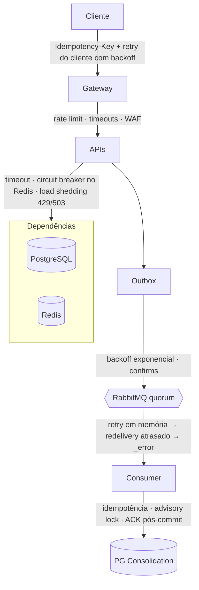

# Estratégia de Resiliência

> Princípio: **cada camada define seu comportamento sob falha**, e o retry acontece **em um único lugar por tipo de operação** (evitar *retry storms* por retries empilhados).

## 1. Mapa de resiliência por camada



## 2. Políticas por tipo de interação

### 2.1 Cliente → APIs

| Aspecto | Política |
|---|---|
| POST financeiro | **`Idempotency-Key` obrigatório** (`400` se ausente). Cliente pode reenviar com segurança |
| Resposta repetida | Mesma chave + mesmo payload → **`201` com o corpo original** e header `Idempotent-Replayed: true` (escolha documentada: preservar a semântica do primeiro resultado) |
| Conflito | Mesma chave + payload diferente → `409` |
| Sobrecarga | `429 Too Many Requests` com `Retry-After` (rate limit por tenant, *token bucket*) |
| Dependência essencial fora | `503` com `Retry-After`, ProblemDetails com `traceId` |
| Timeout de request | 10 s escrita / 5 s leitura (servidor), cancelamento propagado |

### 2.2 APIs → PostgreSQL

| Aspecto | Política |
|---|---|
| Pool | `Maximum Pool Size` dimensionado (ex.: 50/réplica), `Timeout` de aquisição 5 s (métrica de *pool wait*) |
| Command timeout | 5 s leitura, 10 s escrita |
| Retry | `NpgsqlRetryingExecutionStrategy` **apenas** para falhas transitórias de conexão; transação inteira reexecutada pela estratégia (`CreateExecutionStrategy().ExecuteAsync`) — seguro porque a escrita é idempotente pela chave |
| Transações | Curtas; nenhuma chamada de rede externa dentro delas |

### 2.3 Consolidation API → Redis

| Aspecto | Política |
|---|---|
| Timeout | 50–100 ms (`SyncTimeout`/`AsyncTimeout`, `ConnectTimeout`) |
| Circuit breaker | Polly v8 (`Microsoft.Extensions.Resilience`): abre com 50% de falhas em 10 s (mín. 20 chamadas), *break* 30 s |
| Fallback | Leitura direta no PostgreSQL (mesmo contrato — LSP) |
| Stampede | `HybridCache` coalesce requisições simultâneas para a mesma chave |
| Readiness | Redis **não** participa do readiness |

### 2.4 Outbox Publisher → RabbitMQ

| Aspecto | Política |
|---|---|
| Confirmação | Publisher confirms; timeout de confirm 5 s |
| Falha | `RetryCount++`, `NextAttemptAt = now + min(2^n s, 60 s) + jitter`, `LastError` |
| Sem limite de tentativas | Evento financeiro **nunca** é abandonado; após N tentativas (ex.: 20) gera **alerta crítico** e continua tentando |
| Conexão | Reconexão automática do MassTransit; health check do bus no readiness do worker |
| Ordem | `ORDER BY created_at` reduz desordem, mas o consumidor não depende disso |

### 2.5 RabbitMQ → Consumer (MassTransit)

```csharp
cfg.ReceiveEndpoint("consolidation.cash-transaction-created", e =>
{
    e.SetQuorumQueue(3);                 // produção; local usa replicação 1
    e.PrefetchCount = 32;
    e.ConcurrentMessageLimit = 16;       // paralelismo entre contas (lock por conta no banco)

    // 2º nível: redelivery atrasado (requer delayed exchange plugin ou scheduler)
    e.UseDelayedRedelivery(r => r.Intervals(
        TimeSpan.FromSeconds(30), TimeSpan.FromMinutes(2), TimeSpan.FromMinutes(10)));

    // 1º nível: retry em memória para falhas transitórias
    e.UseMessageRetry(r =>
    {
        r.Exponential(3, TimeSpan.FromMilliseconds(200), TimeSpan.FromSeconds(5), TimeSpan.FromMilliseconds(200));
        r.Ignore<InvalidEventContractException>();   // permanente → direto para _error
        r.Ignore<TenantMismatchException>();
    });

    e.ConfigureConsumer<CashTransactionCreatedConsumer>(ctx);
});
```

| Tipo de falha | Exemplo | Tratamento |
|---|---|---|
| Transitória | Timeout/conexão PG, deadlock, serialização | Retry em memória → redelivery atrasado |
| Permanente | Schema inválido, versão desconhecida, moeda divergente da conta | Sem retry → fila `_error` + alerta |
| Duplicada | Mesmo `EventId` | `ProcessedEvents` → ACK sem efeito |
| Fora de ordem / retroativa | `BusinessDate` anterior | Recálculo a partir da data |
| *Poison message* | Crash do processo ao desserializar | `x-delivery-limit` da quorum queue → DLX |

**Error queue nunca é "lixeira":** alerta quando `> 0`, retenção sem TTL, runbook de análise e **replay auditado** ([runbooks](../operations/runbooks.md)).

## 3. Matriz de cenários de falha (testes de resiliência — SPEC §18.3)

| # | Cenário | Comportamento esperado | Como verificar |
|---|---|---|---|
| 1 | Consolidation (API + consumer) parada | Escrita `201`; fila acumula; recuperação drena; projeção correta sem duplicidade | Teste automatizado com Testcontainers + script de demo |
| 2 | RabbitMQ indisponível na publicação | Escrita `201`; Outbox acumula; alerta; drenagem ao voltar | Idem |
| 3 | Publisher cai após confirm e antes de marcar | Republicação com mesmo `EventId`; consumer deduplica | Teste com *fault injection* (hook entre publish e update) |
| 4 | Consumer cai após commit e antes do ACK | Redelivery; `ProcessedEvents` evita reaplicação | *Fault injection* no filtro do MassTransit |
| 5 | PostgreSQL de consolidação indisponível | Consumer não faz ACK; retries; fila acumula; API de consulta `503` | Parar container |
| 6 | Redis indisponível | Consulta `200` via PostgreSQL; breaker abre; métrica de fallback | Parar container |
| 7 | Mensagem malformada | Vai para `_error`; alerta; demais mensagens fluem | Publicar mensagem inválida |
| 8 | Evento duplicado e fora de ordem | Totais corretos; recálculo dos dias posteriores | Teste de integração |
| 9 | Reinício de containers com volumes | Nada perdido; backlog processado | `docker compose restart` |
| 10 | Duas réplicas do consumer na mesma conta | Sem corrida; saldo correto | Teste com 2 instâncias + carga concentrada |
| 11 | Duas réplicas do publisher | Nenhuma mensagem publicada em dobro por claim (só pelo cenário 3) | Teste com 2 workers |
| 12 | POST concorrente com a mesma Idempotency-Key | Exatamente 1 lançamento | Teste paralelo |

## 4. Back-pressure e proteção contra sobrecarga

- **Prefetch** limita mensagens em voo por consumer; RabbitMQ segura o restante de forma durável.
- **KEDA** escala consumers pela profundidade da fila (produção).
- **Rate limiting** por tenant nas APIs evita *noisy neighbor*.
- **Load shedding**: limite de concorrência no Kestrel/`ConcurrencyLimiter` — preferimos rejeitar rápido (`503`) a acumular latência que viola o p95 de todos.
- **Bulkhead**: pools de conexão separados por serviço; workers em processos separados das APIs (um backlog de consumo não consome CPU da API de consulta).

## 5. Graceful shutdown

- Kestrel para de aceitar conexões quando o readiness falha (*draining*), `terminationGracePeriodSeconds: 30`.
- MassTransit `StopAsync` aguarda mensagens em processamento terminarem (sem ACK parcial).
- Outbox Publisher conclui o lote corrente ou aborta antes do publish (linhas voltam a ficar disponíveis).
