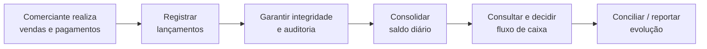
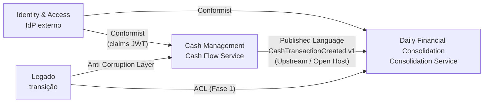

# Mapa de Domínios Funcionais e Capacidades de Negócio

## 1. Cadeia de valor

## 2. Classificação de domínios (DDD estratégico)

| Subdomínio | Tipo | Justificativa | Estratégia |
|---|---|---|---|
| **Gestão de lançamentos (Cash Management)** | **Core** | Integridade financeira, idempotência, imutabilidade — diferencial de confiança | Construir, máximo rigor |
| **Consolidação diária (Daily Financial Consolidation)** | **Core / Supporting** | Valor percebido pelo comerciante (saldo em segundos); regras de saldo e retroativos | Construir |
| Identidade e acesso | Generic | Problema resolvido pelo mercado | Comprar/usar IdP (OIDC) |
| Gestão de comerciantes (cadastro, fuso, status) | Supporting | Necessário, pouco diferencial | Construir simples dentro do Cash Flow na v1 |
| Observabilidade e operação | Generic | Padrões abertos | OpenTelemetry + ferramentas de mercado |
| Conciliação bancária, relatórios, câmbio | Futuro | Fora do escopo v1 | — |

## 3. Bounded contexts e context map

| Relação | Padrão | Significado |
|---|---|---|
| Cash Management → Consolidation | **Published Language + Customer/Supplier** | O produtor publica contrato versionado; consumidor é cliente com necessidades acordadas (ex.: `businessDate` calculada no produtor) |
| IdP → serviços | **Conformist** | Serviços aceitam o modelo de claims do IdP |
| Legado → plataforma | **Anti-Corruption Layer** | Tradução do modelo legado para o canônico |

## 4. Capacidades de negócio

| Nível 1 | Nível 2 (capacidade) | Contexto | Requisitos |
|---|---|---|---|
| **Gestão de caixa** | Gerir contas de caixa | Cash Management | RF-CF-01 |
| | Registrar créditos e débitos | Cash Management | RF-CF-02, RF-CF-03, RF-CF-08 |
| | Registrar saldo de abertura auditável | Cash Management | Regra 12 |
| | Corrigir lançamentos por estorno | Cash Management | RF-CF-07 |
| | Consultar movimentações | Cash Management | RF-CF-04, RF-CF-05 |
| | Garantir não duplicidade | Cash Management | RF-CF-06 |
| | Publicar fatos financeiros | Cash Management | RF-CF-09 |
| **Consolidação financeira** | Consolidar movimentos por dia/conta/moeda | Consolidation | RF-DC-01..04 |
| | Consultar saldo diário e por período | Consolidation | RF-DC-05, RF-DC-06 |
| | Informar atualização e defasagem | Consolidation | RF-DC-07 |
| | Recuperar e reconstruir projeção | Consolidation | RF-DC-08, RF-DC-10 |
| **Segurança e governança** | Isolar dados por comerciante | Transversal | RNF-08 |
| | Autenticar e autorizar por papel | IAM + serviços | §13 |
| | Auditar operações financeiras | Cash Management | Regras 6, 9 |
| **Operação** | Monitorar saúde e SLOs | Transversal | RNF-09 |
| | Reprocessar mensagens em erro | Consolidation + operação | Regra 19 |

## 5. Linguagem ubíqua

| Termo | Definição |
|---|---|
| **Comerciante (Merchant)** | Tenant; proprietário dos dados financeiros |
| **Conta de caixa (Cash Account)** | Caixa de um comerciante, com moeda única e fuso horário |
| **Lançamento (Cash Transaction)** | Fato financeiro imutável: crédito, débito ou abertura |
| **Estorno (Reversal)** | Lançamento compensatório de natureza inversa, ligado ao original |
| **Data operacional (Business Date)** | Data do lançamento no fuso da conta, calculada pelo produtor |
| **OccurredAt / CreatedAt** | Quando o fato ocorreu / quando o sistema registrou |
| **Saldo de abertura / fechamento** | Saldo no início / fim do dia operacional |
| **Consolidado diário** | Projeção com créditos, débitos, abertura e fechamento por dia |
| **Defasagem (Lag)** | Tempo entre o fato registrado e sua aplicação na projeção |
| **Watermark** | Maior sequência contígua de eventos aplicada por conta |

## 6. Atores e permissões

| Ator | Permissões (scopes/policies) |
|---|---|
| Administrador do comerciante | `accounts:manage`, `transactions:read`, `balances:read` |
| Operador financeiro | `transactions:write`, `transactions:read` |
| Consultor financeiro | `balances:read` (e opcionalmente `transactions:read`) |
| Administrador da plataforma | Operacional (`ops:replay`, métricas); **sem** acesso a dados financeiros por padrão |
| Serviço (integração M2M) | Client credentials com scopes mínimos |
