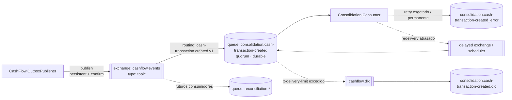

# Contratos de Eventos e Topologia de Mensageria

## 1. `CashTransactionCreated` — v1

Contrato único para lançamentos e estornos (SPEC §9.2).

```json
{
  "eventId": "0193a6f2-6c1e-7b3a-9d2f-1c4e5a6b7c8d",
  "eventType": "CashTransactionCreated",
  "schemaVersion": 1,
  "occurredOn": "2026-11-17T17:30:00Z",
  "merchantId": "UUID",
  "cashAccountId": "UUID",
  "transactionId": "UUID",
  "transactionType": "CREDIT",
  "amount": 500.00,
  "currency": "BRL",
  "businessDate": "2026-11-17",
  "reversesTransactionId": null,
  "accountSequence": 42,
  "correlationId": "UUID"
}
```

| Campo | Tipo | Obrigatório | Regra |
|---|---|---|---|
| `eventId` | uuid | ✅ | Estável e único; = `MessageId` AMQP; = PK da Outbox |
| `eventType` | string | ✅ | `CashTransactionCreated` |
| `schemaVersion` | int | ✅ | `1` |
| `occurredOn` | datetime UTC | ✅ | Momento do registro do fato no produtor (`CreatedAt`) |
| `merchantId` | uuid | ✅ | Tenant |
| `cashAccountId` | uuid | ✅ | |
| `transactionId` | uuid | ✅ | |
| `transactionType` | enum | ✅ | `CREDIT`, `DEBIT`, `OPENING_BALANCE` |
| `amount` | decimal | ✅ | `> 0`, até 4 casas; serializado como número JSON |
| `currency` | string(3) | ✅ | ISO 4217 |
| `businessDate` | date | ✅ | Calculada **no produtor** com o fuso da conta; o consumidor **não recalcula** |
| `reversesTransactionId` | uuid? | ❌ | Preenchido em estornos (tipo já invertido) |
| `accountSequence` | long? | ❌ | **Campo aditivo** — sequência monotônica por conta para watermark (ADR-013) |
| `correlationId` | uuid | ✅ | Correlação de negócio; trace context vai no header `traceparent` |

**Dados pessoais:** nenhum. `description` **não** é publicado (não é necessário para consolidação e pode conter texto livre sensível).

### Regras de evolução
- **Compatível (mesma versão):** adicionar campos opcionais. Consumidores são *tolerant readers* (ignoram campos desconhecidos).
- **Incompatível:** remover/renomear campo, mudar tipo/semântica → `CashTransactionCreated` **v2** publicado **em paralelo** com v1 durante a migração dos consumidores; v1 descontinuada com aviso.
- **Testes de contrato** no CI: JSON Schema em `src/BuildingBlocks/Contracts/schemas/cash-transaction-created.v1.json` validado contra amostras do produtor e do consumidor.

## 2. Topologia RabbitMQ



| Recurso | Configuração |
|---|---|
| Vhost | `cashflow` |
| Exchange | `cashflow.events` (topic, durable) — nome explícito, desacoplado do nome do tipo .NET |
| Fila de consumo | `consolidation.cash-transaction-created` — quorum (prod), durable, `x-delivery-limit=10` |
| Error queue | `..._error` (MassTransit) — sem TTL, monitorada |
| DLX | `cashflow.dlx` → `*.dlq` para *poison messages* |
| Mensagem | `content_type=application/json`, `delivery_mode=2`, `message_id=eventId`, headers `traceparent`, `schema-version` |

> MassTransit cria topologia por convenção de tipo; configuramos **nomes explícitos** (`EntityNameFormatter`/`SetEntityName`) para que o contrato no broker não dependa do namespace C#.

## 3. Permissões no RabbitMQ (menor privilégio)

| Usuário | Vhost | configure | write | read |
|---|---|---|---|---|
| `cashflow-publisher` | cashflow | `^$` (nenhum — topologia criada por definitions) | `^cashflow\.events$` | `^$` |
| `consolidation-consumer` | cashflow | `^consolidation\..*` | `^consolidation\..*` (error/redelivery) | `^consolidation\..*` |
| `ops-replay` | cashflow | `^$` | `^consolidation\..*` | `^consolidation\..*_error$` |
| `admin` | — | uso humano apenas, MFA no painel, não usado por aplicações | | |

Topologia declarada em `deploy/rabbitmq/definitions.json` (infra como código), e não criada dinamicamente por aplicações em produção.

## 4. Segurança da integração (critérios de consumo de serviços)

| Critério | Aplicação |
|---|---|
| Autenticação no broker | Usuário por serviço; credenciais em Secret Manager; rotação |
| Transporte | **AMQPS (TLS 1.2+)** em cloud; mTLS opcional |
| Autorização | Permissões por vhost/regex (acima) |
| Integridade/origem | Consumer valida `merchantId`/`cashAccountId` presentes, tipo, versão e moeda; rejeita para `_error` se inválido |
| Minimização | Sem dados pessoais nem descrições livres no evento |
| Auditoria | `eventId`, `correlationId`, `traceparent` permitem rastrear cada evento |
| Replay | Só por usuário `ops-replay`, com registro de quem/quando/por quê |

## 5. APIs REST (resumo)

OpenAPI gerado por `Microsoft.AspNetCore.OpenApi` (documento em `/openapi/v1.json`) com UI em `/swagger`. Contratos detalhados no [SPEC §8](../../SPEC.md#8-contratos-de-api). Erros em **ProblemDetails (RFC 9457)** com `traceId`.

| Serviço | Método | Rota | Policy |
|---|---|---|---|
| Cash Flow | POST | `/api/v1/cash-accounts` | `accounts:manage` |
| Cash Flow | POST | `/api/v1/transactions` | `transactions:write` + `Idempotency-Key` |
| Cash Flow | GET | `/api/v1/transactions/{id}` | `transactions:read` |
| Cash Flow | GET | `/api/v1/transactions?cashAccountId&from&to&page&pageSize` | `transactions:read` |
| Cash Flow | POST | `/api/v1/transactions/{id}/reversals` | `transactions:write` + `Idempotency-Key` |
| Consolidation | GET | `/api/v1/daily-balances?cashAccountId&from&to` | `balances:read` |
| Consolidation | GET | `/api/v1/daily-balances/{businessDate}?cashAccountId` | `balances:read` |
| Consolidation | GET | `/api/v1/daily-balances/status?cashAccountId` | `balances:read` |
| Ambos | GET | `/health/live`, `/health/ready` | anônimo (rede interna) |
