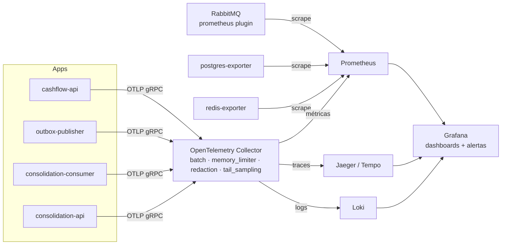

# Observabilidade — Monitoramento, Dashboards e Alertas

## 1. Arquitetura de telemetria

## 2. Sinais

### Traces
- Instrumentações: ASP.NET Core, HttpClient, Npgsql/EF Core, StackExchange.Redis, MassTransit.
- **Propagação pelo broker:** `traceparent` salvo na Outbox → header AMQP → contexto restaurado no consumer. Um trace mostra: `POST /transactions` → `INSERT` → (assíncrono) `outbox publish` → `consume` → `UPDATE daily_balances`.
- Atributos permitidos: `merchant.id` (se a política permitir), `cash_account.id`, `event.id`, `messaging.*`. **Proibido:** valores, descrições, tokens.
- Amostragem: tail sampling — 100% de erros e requisições > 500 ms; 10% do restante (ajustável).

### Métricas

| Métrica | Tipo | Origem |
|---|---|---|
| `http.server.request.duration` (p50/p95/p99, por rota e status) | Histograma | ASP.NET Core |
| `cashflow.transactions.registered` | Counter | App |
| `cashflow.idempotency.replays` / `.conflicts` | Counter | App |
| `cashflow.outbox.pending` | Gauge | App (query periódica) |
| `cashflow.outbox.oldest_age_seconds` | Gauge | App |
| `cashflow.outbox.publish.duration` / `.failures` | Histograma / Counter | App |
| `consolidation.events.processed` | Counter | App |
| `consolidation.events.duplicates` | Counter | App |
| `consolidation.lag_seconds` (commit → aplicado) | Histograma | App |
| `consolidation.recalculated_days` | Histograma | App |
| `consolidation.consumer.duration` / `.failures` | Histograma / Counter | MassTransit + App |
| `rabbitmq_queue_messages_ready` / `_unacked` | Gauge | RabbitMQ |
| Profundidade da `_error` queue | Gauge | RabbitMQ |
| `db.client.connections.usage` / `.wait_time` | Gauge / Histograma | Npgsql |
| `cache.hits` / `cache.misses` / `cache.fallbacks` | Counter | App |
| CPU, memória, GC, thread pool | — | Runtime instrumentation |

### Logs
- Estruturados (JSON) via `ILogger` → OTLP. Campos: `TraceId`, `SpanId`, `CorrelationId`, `EventId`, `MerchantId` (conforme política), `service.name`, `service.version`, `deployment.environment`.
- Níveis: `Information` para eventos de negócio relevantes (sem valores), `Warning` para retries, `Error` para falhas e envio para `_error`.

## 3. Dashboards (Grafana, provisionados como código)

| # | Dashboard | Painéis principais |
|---|---|---|
| 1 | **Saúde das APIs** | RPS, taxa de erro por status, p50/p95/p99 por rota, `429/503`, readiness |
| 2 | **Pipeline de eventos** | Outbox pending/oldest age, publish rate/falhas, queue depth/unacked, consumer rate/duração |
| 3 | **Atraso da consolidação** | `lag_seconds` p50/p95 vs SLO 5 s, contas em `DELAYED`, dias recalculados |
| 4 | **Erros e quarentena** | `_error`/DLQ depth, top exceções, duplicatas, replays |
| 5 | **Performance e recursos** | CPU/memória por container, pool de conexões PG, latência de queries, cache hit ratio, latência Redis |

## 4. Alertas

| Alerta | Condição (exemplo) | Severidade | Ação |
|---|---|---|---|
| Lag de consolidação | `lag_seconds` p95 > 5 s por 5 min | Warning → Critical se > 60 s | Ver dashboard 2/3; escalar consumer |
| Outbox envelhecendo | `oldest_age_seconds` > 30 s por 2 min | Critical | Verificar broker/publisher |
| Error queue | `_error` > 0 | Critical (dado financeiro) | Runbook "Mensagens em erro" |
| Backlog crescente | queue depth crescendo por 10 min | Warning | Escalar consumer / investigar |
| Taxa de erro API | 5xx > 1% por 5 min (SLO) | Critical | Investigar trace/logs |
| Latência | p95 > 300 ms por 10 min (consolidation) | Warning | Ver cache/DB |
| Banco sem conexões | pool wait p95 > 1 s ou conexões > 90% | Critical | Pool/PgBouncer |
| Readiness | serviço sem réplica ready | Critical | — |
| Burn rate de SLO | consumo do error budget 14× em 1 h | Page | Multi-window, multi-burn-rate |

## 5. SLOs e SLIs

| SLI | SLO |
|---|---|
| Disponibilidade POST `/transactions` (2xx+4xx esperados / total) | 99,95% / 30 dias |
| Disponibilidade GET `/daily-balances` | 99,9% / 30 dias (e ≥ 95% em pico — requisito) |
| Latência p95 GET `/daily-balances` | ≤ 300 ms |
| Freshness: p95 `lag_seconds` | ≤ 5 s |
| Integridade: lançamentos sem evento aplicado após 1 h | 0 (reconciliação) |
