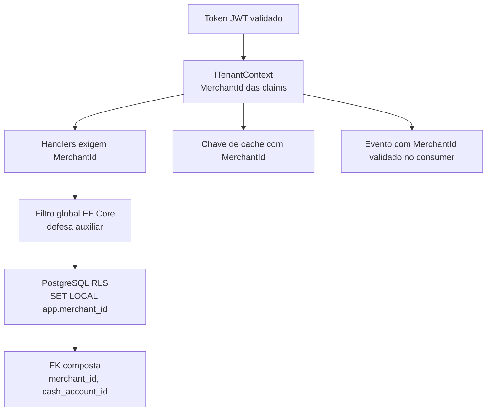

# Estratégia de Segurança e Multi-tenancy

## 1. Modelo de ameaças (STRIDE resumido)

| Ameaça | Exemplo | Controle |
|---|---|---|
| **S**poofing | Token forjado; header `X-Merchant-Id` manipulado | JWT validado (issuer, audience, assinatura via JWKS, expiração, clock skew curto); tenant **só** de claims |
| **T**ampering | Alterar valor de lançamento; mensagem adulterada | Imutabilidade (sem UPDATE/DELETE); TLS; usuários de broker com permissão mínima |
| **R**epudiation | "Não fui eu que lancei" | `sub` do usuário registrado no lançamento (auditoria), logs com `TraceId` |
| **I**nformation disclosure | Ler dados de outro comerciante; logs com dados financeiros | 8 camadas de isolamento (ADR-007); `404` cross-tenant; redaction de logs |
| **D**enial of service | Rajada na API de consulta | WAF, rate limit por tenant, limites de payload, load shedding |
| **E**levation of privilege | Operador estornar sem permissão; admin da plataforma ler saldos | Policies por scope; admin de plataforma sem acesso financeiro por padrão |

## 2. Autenticação

- **Produção:** OIDC com IdP (Keycloak, Microsoft Entra ID, Auth0, Amazon Cognito). APIs validam **JWT Bearer**: `iss`, `aud`, assinatura (JWKS com cache e rotação), `exp`/`nbf`, `ClockSkew` ≤ 30 s.
- **Local:** duas opções, documentadas no README:
  1. **Keycloak em container** com realm pré-importado (usuários de dois comerciantes) — preferida se não comprometer a simplicidade.
  2. **Handler de autenticação de desenvolvimento** que emite tokens assinados localmente. **Impossível ativar em produção:** o registro do handler só ocorre se `IHostEnvironment.IsDevelopment()` **e** `Authentication:Mode=Development`; em qualquer outro ambiente, a aplicação **falha no startup** se esse modo estiver configurado.
- **Serviço a serviço (futuro/integrações externas):** OAuth2 **client credentials** com scopes mínimos; mTLS em service mesh quando houver.

## 3. Autorização

| Policy | Requisito |
|---|---|
| `accounts:manage` | scope/role + tenant ativo |
| `transactions:write` | scope/role + tenant ativo |
| `transactions:read` | scope/role + tenant ativo |
| `balances:read` | scope/role + tenant ativo |
| `ops:replay` | papel operacional; **sem** acesso a dados financeiros |

**Autorização sempre combinada com tenant:** toda consulta filtra por `MerchantId` do `ITenantContext`; recursos de outro tenant retornam `404`.

**Usuário em múltiplos comerciantes:** seleção explícita de contexto (ex.: token com `merchant_id` emitido após escolha, ou *token exchange*) com validação server-side da associação usuário-comerciante. Nunca um header arbitrário.

## 4. Isolamento multiempresa — camadas

**Testes negativos obrigatórios (CI):**
- Comerciante B lê transação de A → `404`.
- B lista transações da conta de A → `404`/lista vazia sem vazamento.
- B registra lançamento na conta de A → `404` (e FK composta impede no banco).
- B estorna transação de A → `404`.
- B consulta consolidado da conta de A → `404`.
- Cache: chave de A nunca atende requisição de B (teste do `ICacheKeyStrategy`).

## 5. Proteção de dados e infraestrutura

| Controle | Implementação |
|---|---|
| Criptografia em trânsito | TLS na borda; TLS para PostgreSQL, Redis e AMQPS em cloud |
| Criptografia em repouso | Discos/serviços gerenciados com criptografia (KMS) |
| Segredos | Nunca versionados; `.env.example` sem segredos reais; produção: Key Vault/Secrets Manager + External Secrets; rotação |
| Exposição de rede | PostgreSQL, Redis, RabbitMQ sem IP público; redes internas; NetworkPolicies em K8s |
| Rate limiting | Gateway + `AddRateLimiter` por tenant (`429` com `Retry-After`) |
| Validação de entrada | Limites de tamanho de body (ex.: 16 KB), tamanhos de string, `pageSize ≤ 100`, período ≤ 366 dias |
| Headers de segurança | HSTS, `X-Content-Type-Options`, sem `Server` header |
| Logs | Sem tokens, segredos, payloads financeiros completos; `MerchantId` conforme política de privacidade |
| Erros | ProblemDetails sem stack trace/dados sensíveis em produção |
| Supply chain | Dependabot/Renovate, `dotnet list package --vulnerable`, scan de imagem (Trivy), imagens base mínimas (chiseled), assinatura (cosign), SBOM |
| Containers | Não-root, `readOnlyRootFilesystem`, `drop ALL capabilities` |
| LGPD | Minimização (eventos sem dados pessoais), retenção definida, acesso por papel, trilha de auditoria |

## 6. Critérios de segurança para consumo (integração) de serviços

1. Todo consumidor de API se autentica (OIDC/client credentials) — sem API keys estáticas compartilhadas.
2. Scopes mínimos por cliente; tokens de curta duração.
3. Rate limit e quota por cliente/tenant.
4. Contratos versionados e validados (OpenAPI/JSON Schema); entradas validadas sempre no servidor.
5. Idempotência obrigatória para operações financeiras (`Idempotency-Key`).
6. Mensageria: usuário por serviço, vhost dedicado, AMQPS, permissões por regex, payload mínimo.
7. Observabilidade de acesso: logs de autenticação/autorização negada com `TraceId`, alertas de anomalia (picos de `401/403/404`).
