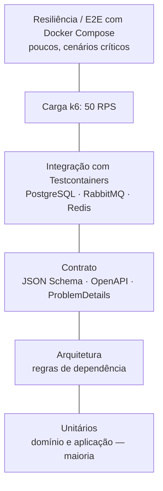

# Estratégia de Testes

## 1. Pirâmide



| Tipo | Ferramentas | Executa em |
|---|---|---|
| Unitários | xUnit v3, asserts nativos ou Shouldly (evitar FluentAssertions v8+ por licença), `FakeTimeProvider` | Todo commit |
| Arquitetura | NetArchTest / ArchUnitNET | Todo commit |
| Contrato | JSON Schema (eventos), snapshot do OpenAPI, ProblemDetails | Todo commit |
| Integração | Testcontainers (PostgreSQL, RabbitMQ, Redis), `WebApplicationFactory`, MassTransit Test Harness | Todo PR |
| Resiliência | Testcontainers + *fault injection* / scripts Compose | PR (subconjunto) e nightly |
| Carga | **k6** (Apache-2/AGPL, CLI simples, saída para Prometheus) | Sob demanda / release |

## 2. Casos obrigatórios (SPEC §18)

**Cash Flow (unitários):** crédito válido; débito válido; valor zero/negativo rejeitado; mais de 4 casas rejeitado; conta de outro comerciante rejeitada; moeda diferente da conta rejeitada; estorno integral; estorno duplicado rejeitado; estorno de estorno rejeitado; `BusinessDate` com fuso (`America/Sao_Paulo`: 2026-11-17T23:30-03:00 → 2026-11-17; 2026-11-18T01:00Z → 2026-11-17); idempotência (replay e conflito).

**Consolidação (unitários):** soma de créditos/débitos; abertura/fechamento; dia sem movimento; evento duplicado; evento retroativo recalcula dias posteriores; fora de ordem produz o mesmo resultado que em ordem (**teste de propriedade**: permutações aleatórias da mesma lista de eventos → mesma projeção); isolamento por conta, moeda e comerciante; status `CURRENT/PROCESSING/DELAYED/UNKNOWN`.

**Integração:** persistência PG; atomicidade transação + Outbox (falha forçada após `INSERT` → nada persistido); Outbox → RabbitMQ; ACK só após commit; duplicado sem efeito duplicado; `_error` em falha permanente; Redis + fallback; migrations em banco vazio; RLS; testes negativos cross-tenant (ver [segurança](../security/seguranca-multiempresa.md)); concorrência de mesma `Idempotency-Key`.

**Resiliência:** matriz completa em [08-resiliencia.md §3](../architecture/08-resiliencia.md#3-matriz-de-cenários-de-falha-testes-de-resiliência--spec-183).

## 3. Teste de carga — 50 RPS

**Cenários distintos (não misturar sem identificar):**
1. `read-sustained`: 50 RPS constantes por 15 min (após 2 min de aquecimento) em `GET /daily-balances` (período) e `GET /daily-balances/{date}` (70/30).
2. `read-spike`: 50 RPS por 5 min partindo de 5 RPS (rampa em 10 s).
3. `write-nominal`: 10 RPS de POST com `Idempotency-Key` únicas, medindo lag de consolidação.
4. `mixed`: 1 + 3 simultâneos.
5. `stress` (opcional): rampa até 200 RPS para descobrir o ponto de saturação.

**Dataset:** 200 comerciantes × 3 contas × 365 dias de movimento, distribuição de acesso Zipf leve (evitar que um único tenant distorça).

**Thresholds (k6):**
```javascript
export const options = {
  scenarios: {
    read_sustained: { executor: 'constant-arrival-rate', rate: 50, timeUnit: '1s',
                      duration: '15m', preAllocatedVUs: 50, maxVUs: 200 },
  },
  thresholds: {
    http_req_failed:   ['rate<0.05'],          // requisito do desafio (meta interna < 0.005)
    http_req_duration: ['p(95)<300', 'p(99)<800'],
  },
};
```
`constant-arrival-rate` é essencial: mantém 50 RPS independentemente da latência (modelo aberto), evitando o *coordinated omission*.

**Medir e registrar:** throughput; 2xx/4xx/5xx; timeouts; p50/p95/p99; CPU/memória por container; pool de conexões; latência PG; cache hit ratio; limites Docker (`cpus`, `mem_limit`); hardware; versão do commit; comando exato.

**Relatório:** `docs/testing/relatorio-carga-AAAA-MM-DD.md`. **Nenhuma meta é declarada atingida sem esse relatório** (SPEC §6.1).

## 4. CI (GitHub Actions)

```text
restore → build (warnings as errors) → unit + architecture + contract
       → integration (Testcontainers) → vulnerable packages check
       → docker build (todas as imagens) → docker compose config → scan de imagem (Trivy)
```
